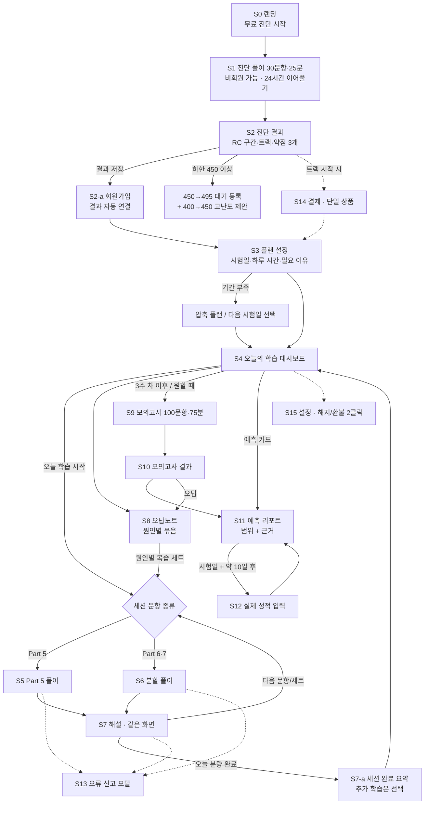

# S1-06 핵심 학습 흐름 스케치 (MVP)

- 작성: UX/UI Designer / 보고 대상: Chief of Staff / 작성일: 2026-10-13 / 버전: v0.1 (스케치)
- 입력: `docs/specs/vision.md`(W1·W2·W3), `docs/roadmap.md`(F1~F10 수용 기준), `docs/research/personas.md`(P1~P4), `docs/cs/competitor-complaints.md`(불만 유형 1~12), `docs/qa/content-standard.md`(유형 태그·해설 필드)
- 프로토타입: `prototypes/part7-split.html` (Part 7 이중 지문 분할 풀이 + 해설 + 근거 하이라이트 + 오류 신고, 외부 의존성 없음)
- 표기: **[명세]** roadmap 수용 기준을 그대로 화면에 옮긴 것 / **[제안]** 디자이너가 더한 것(승인 필요) / **[수정안]** 명세와 다르게 가자고 제안하는 것(근거 포함)
- 불만 번호 `C1~C12`는 competitor-complaints.md 2장 불만 유형표 번호다. 예: C9 = UX 복잡·모바일 가독성.

---

## 0. 결론 요약

1. **화면 15개, 핵심 루프는 6개다.** 진단 → 진단 결과 → 플랜 설정 → **대시보드** → **풀이(Part 5 / Part 6·7 분할)** → **해설(같은 화면)** → 오답노트 → 모의고사 → **예측 리포트** → 실제 성적 입력. 오류 신고(F9)는 모든 문항 화면에 붙은 모달이고, 결제(F10)는 진단 결과 이후와 설정 화면 두 곳에만 나온다.
2. **"열고 10초 안에 공부 시작"을 대시보드 한 버튼으로 지킨다.** 대시보드 첫 화면의 주 버튼은 하나("오늘 학습 시작 · 25분")뿐이다. 트랙·예측·졸업 조건은 그 아래 보조 정보다.
3. **W2는 "풀이 화면을 떠나지 않는 해설"로 보여 준다.** 채점하면 오른쪽 문항 패널이 해설 패널로 바뀌고, "근거 보기"를 누르면 왼쪽 지문에서 근거 문장이 하이라이트되며 그 위치로 스크롤된다. 내가 고른 오답의 함정 이름이 해설 맨 위에 온다.
4. **W3는 "숫자 하나"를 쓰지 않는다.** 예측은 항상 막대 위 범위(하한~상한)와 중앙값, "베타 예측" 라벨, 근거 문항 수를 같이 보여 준다. 숫자가 10점 이상 바뀌면 이유를 한 줄로 붙인다.
5. **명세 수정안 4개**를 7장에 정리했다. 가장 중요한 것은 (a) Part 6·7은 기본을 "세트 채점"으로 하고 (b) 문항에 "확신 없음" 표시를 두어 F5 '찍음' 원인을 채점 전에 받자는 것이다.

---

## 1. 디자인 원칙 (이 문서 전체에 적용)

| # | 원칙 | 왜 (근거) | 화면에 나타나는 방식 |
|---|---|---|---|
| D1 | **한 화면 한 주 버튼** | 해커스 "메뉴·웹사이트 복잡"(C9), 디자인 목표 "10초 안에 시작" | 화면마다 채워진(primary) 버튼은 하나. 나머지는 외곽선·텍스트 버튼 |
| D2 | **떠나지 않는 학습** | 해커스 해설 동선 "웹 방문·코드 입력·로그인"(C5) | 해설·오류 신고·오답 원인 수정이 모두 풀이 화면 안에서 끝난다. 페이지 이동 0회 |
| D3 | **숫자에는 근거를 붙인다** | 산타 "예상 점수가 후하다", "세트를 다 맞혀도 점수가 떨어진다"(C6) | 예측·졸업 조건·정답률 옆에 "근거 n문항", "바뀐 이유" 한 줄 |
| D4 | **사용자가 통제한다** | 픽토 "학습 자율성 부족·글자 크기 고정·이전 문제 복귀 불가"(C9) | 글자 크기 4단계, 자유 이동, 타이머 숨기기, 원인 태그 수정, 추가 학습은 선택 |
| D5 | **혼동 없는 버튼** | 픽토 "채점·다음 버튼 혼동"(C9) | "채점하기"와 "다음 문항"은 위치·색·라벨·아이콘이 모두 다르다. 채점은 되돌릴 수 없으므로 확인 단계를 둔다(미응답이 있을 때만) |
| D6 | **숨기지 않는 돈 이야기** | "뭘 골라도 손해 보는 요금"(C3), 해지 동선 은닉, 리워드형 분쟁(C1·C2) | 상품 1개, 가격·기간·환불 3줄. 해지·환불은 설정에서 2번 클릭 |
| D7 | **색만으로 전달하지 않는다** | WCAG 2.1 AA (1.4.1) | 정답·오답·근거·함정은 색 + 아이콘 + 텍스트 라벨을 함께 쓴다 |

---

## 2. 흐름 개요

### 2.1 전체 흐름도



> 결제(S14)가 진단 결과와 플랜 설정 사이에 오는지, 무료 체험 이후에 오는지는 열린 질문 Q1·Q2(가격 모델)에 달려 있다. 이 문서는 "클로즈드 베타 = 무료"를 기본으로 그렸고, 결제 접점은 점선으로 표시했다.

### 2.2 화면 목록과 이길 지점

| ID | 화면 | 기능 | 주 지점 | 우선 페르소나 | 핵심 화면 여부 |
|---|---|---|---|---|---|
| S0 | 랜딩·진단 시작 | F1 | W1 | P1·P3 | |
| S1 | 진단 풀이 | F1, F3 | W1·W3 | 전원 | |
| S2 | 진단 결과 (+가입) | F1, F10 | W1·W3 | 전원 | ● |
| S3 | 플랜 설정 | F2 | W1 | P1·P2 | |
| S4 | 오늘의 학습 대시보드 | F2, F7 | W1·W3 | 전원 | ●● (와이어프레임) |
| S5 | Part 5 풀이 | F3 | W2 | P1·P3 | |
| S6 | Part 6·7 분할 풀이 | F3 | W2 | P2·P3 | ●● (와이어프레임·프로토타입) |
| S7 | 근거 해설 (풀이 화면 안) | F4, F5 | W2 | P2·P4 | ●● (와이어프레임) |
| S7-a | 세션 완료 요약 | F2 | W1 | 전원 | |
| S8 | 오답노트 | F5 | W2 | P2 | ● |
| S9 | 모의고사 | F6 | W3 | P2·P3 | |
| S10 | 모의고사 결과 | F6 | W3 | P2·P3 | |
| S11 | 예측 리포트 | F7 | W3 | P3·P2 | ●● (와이어프레임) |
| S12 | 실제 성적 입력 | F8 | W3 | 전원 | |
| S13 | 오류 신고 모달 | F9 | W2 | 전원 | |
| S14 | 결제 | F10 | 기반(D6) | P1·P3 | |
| S15 | 설정 (계정·해지·환불·표시) | F10, F3 | 기반(D6) | 전원 | |

---

## 3. 화면별 명세

각 화면은 같은 틀로 적는다: **목적 / 주요 요소 / 상호작용 / 빈 상태·오류 상태 / 지점 / 경쟁사 대비**.

### S0. 랜딩·진단 시작

- **목적**: 가입 없이 진단을 시작하게 한다. "RC만, 시험일까지"라는 W1 메시지를 첫 화면에서 전달한다.
- **주요 요소**: 한 줄 메시지(마케터 S1-09 확정 전 자리표시: "LC는 됐고, RC만 50점 더."), 주 버튼 "무료 RC 진단 시작 · 25분 · 가입 없이", 진단 구성 한 줄(Part 5 12 · Part 6 4 · Part 7 14), "이어 풀기" 배너(진행 중인 진단이 있으면).
- **상호작용**: 주 버튼 → S1 1번 문항 바로 진입 [명세 F1-1]. 로그인 사용자는 S4로 바로 보낸다.
- **빈·오류 상태**: 진행 중 진단이 24시간을 넘었으면 "이전 진단은 만료됐어요. 처음부터 다시 풀어요(약 25분)" 안내. 문항 로딩 실패 시 "다시 시도" 버튼 + 오류 코드.
- **지점**: W1.
- **경쟁사 대비**: 산타의 3일 체험·요금제 선택(C3)보다 앞서, 결제·가입 결정을 진단 뒤로 미룬다.

### S1. 진단 풀이 (30문항·25분)

- **목적**: 구간 판정용 응답과 문항별 시간을 모은다.
- **주요 요소**: 상단 바(남은 시간, 진행률 n/30, 글자 크기), 본문은 S5/S6 레이아웃 재사용, 문항 목록 서랍(푼/안 푼/표시).
- **상호작용**: 진단 중에는 **해설을 보여 주지 않는다**(측정 오염 방지). 채점은 30문항 제출 또는 25분 경과 시 한 번. 이동 자유, 답 변경 자유. 제출 전 "안 푼 문항 n개" 확인.
- **빈·오류 상태**: 네트워크 끊김 → 응답은 로컬에 임시 저장, 상단에 "오프라인 · 연결되면 자동 저장" 배지. 브라우저 종료 → 24시간 안 재접속 시 마지막 문항 다음부터 [명세 F1-2]. 남은 시간 5분·1분에 한 번씩 알림(스크린리더 aria-live polite).
- **지점**: W1(트랙 배정), W3(예측의 첫 근거).
- **경쟁사 대비**: 산타 "너무 빨리 풀면 경고 후 점수 미반영"(C6)처럼 몰래 버리지 않는다. 빠른 응답은 반영하되 결과 화면에 "10초 안에 답한 문항 n개"로 드러낸다 [제안].

### S2. 진단 결과 (+ 가입 연결)

- **목적**: "내 RC가 지금 어디고, 어떤 트랙으로, 무엇이 약한지"를 한 화면에서 이해시키고 플랜으로 넘긴다.
- **주요 요소**
  - RC 추정 구간 막대: "RC 330~390 (중앙 360) · 베타 예측 · 근거 30문항" + 총점 환산 참고 한 줄("총점으로는 대략 …" [추정 표기]).
  - 배정 트랙 카드: "300→400 트랙 추천" + 졸업 조건 3개 미리보기.
  - Part 5·6·7 정답률 막대 3개, 약점 상위 3개 유형(유형 태그 대분류 한국어 이름: "동사 · 시제", "연결어 · 전치사 vs 접속사" 등).
  - 시간: 시간 초과 문항 수, 10초 안에 답한 문항 수.
  - 주 버튼: "내 플랜 만들기"(비회원이면 "결과 저장하고 플랜 만들기").
- **상호작용**: 주 버튼 → 가입(이메일 또는 소셜 1종) → 결과 자동 연결 [명세 F1-5] → S3. 약점 유형을 누르면 해당 유형 문항 2개를 미리 보여 준다(해설 포함) [제안 — 해설 품질이 W2의 첫인상이다].
- **빈·오류 상태**
  - 하한 450 이상: "450→495 트랙은 준비 중" + 대기 등록 + "400→450 고난도 세션으로 시작" [명세 F1-4].
  - 응답 15문항 미만(시간 초과로 대량 미응답): 구간 대신 "판정하기에 응답이 부족해요(15/30). 남은 문항을 이어 풀면 결과가 정확해져요" + 이어 풀기 [제안].
  - 가입 실패·이메일 중복: 결과는 로컬에 남기고 "로그인하면 이 결과를 연결해요".
- **지점**: W1, W3.
- **경쟁사 대비**: 총점 한 숫자 대신 RC 구간과 근거 문항 수를 같이 준다(C6). 결제 유도 화면이 아니라 플랜 화면으로 넘긴다(C3).

### S3. 플랜 설정

- **목적**: 시험일·하루 시간·필요 이유 세 가지만 받아 주차별 플랜과 졸업 조건을 만든다.
- **주요 요소**: 3단계 한 화면 폼(스텝 아님): ① 시험 예정일(정기시험 일정 칩 + 직접 선택) ② 평일 하루 학습 시간 15/25/40분 세그먼트 ③ 점수가 필요한 이유(공무원·공기업 / 승진 / 기업 지원 / 졸업 / 기타) [명세 F2-1]. 아래에 실시간 미리보기: "6주 · 주 5회 · 하루 25분 · 총 30세션", 주차별 파트 비중 막대.
- **상호작용**: 입력이 바뀌면 미리보기 즉시 갱신. 주 버튼 "이 플랜으로 시작" → S4.
- **빈·오류 상태**
  - 기간이 권장 6주보다 짧음: 경고 배너 "남은 기간이 4주라 하루 40분이 필요해요" + 선택지 2개 "압축 플랜(하루 40분)" / "다음 시험일(11월 22일)로" [명세 F2-2]. 경고는 노란 배너 + 아이콘, 막지 않는다.
  - 시험일이 지난 날짜·3일 이내: 선택 불가 + 이유 텍스트.
  - 시험일 미정: "아직 안 정했어요" 선택 시 기본 6주 플랜, 대시보드에 "시험일을 정하면 플랜이 맞춰져요" 알림.
- **지점**: W1.
- **경쟁사 대비**: 산타 30/90일 기간권·"패키지를 잘못 골라 시험 후에도 출석"(C3) 대신, 시험일에서 거꾸로 계산한다.

### S4. 오늘의 학습 대시보드 ★

- **목적**: 접속 후 10초 안에 오늘 학습을 시작하게 한다. 두 번째로, 시험일까지 남은 거리(졸업 조건·예측)를 숫자로 보여 준다.
- **주요 요소** (위에서 아래 순서 = 중요도 순서)
  1. 오늘 카드: "D-32 · 3주 차 2일째", 오늘 세션 구성("Part 5 8문항 · Part 7 단일 2세트 · 복습 3문항 · 약 25분"), **주 버튼 "오늘 학습 시작"**. 진행 중이면 "이어서 하기 (12/18)".
  2. 플랜 변경 알림(있을 때만, 한 줄): "어제·그제 건너뛰어서 남은 4주에 6세션을 나눠 넣었어요 · 되돌리기" [명세 F2-4, 되돌리기는 제안].
  3. 졸업 조건 카드: 조건 3개를 "현재 값 / 목표 값" 막대로 [명세 F2-3]. 예: Part 5 정답률 78% / 85%.
  4. RC 예측 카드: 범위 막대 + 중앙값 + "베타 예측" + 근거 문항 수, 10점 이상 변동 시 바뀐 이유 한 줄 [명세 F7-1, F7-4]. 카드 전체를 누르면 S11.
  5. 이번 주 진행: 세션 5칸(완료/오늘/남음), 연속 학습 일수(스트릭은 보조 정보, 끊겨도 벌점 문구 없음).
  6. 보조 링크: 오답노트(묶음 n개), 모의고사(3주 차부터 활성), 설정.
- **상호작용**: 주 버튼 → 세션 첫 문항(Part 5면 S5, 세트면 S6). 졸업 조건 막대 → 해당 조건의 근거 문항 목록. 예측 카드 → S11.
- **빈·오류 상태**
  - 플랜 없음(진단만 하고 이탈): 오늘 카드 자리에 "플랜을 만들면 오늘 할 공부가 여기 나와요" + "플랜 만들기".
  - 오늘 분량 완료: 오늘 카드가 "오늘 분량 완료 ✓"로 바뀌고 주 버튼이 사라진다. 보조 버튼 "더 풀기(선택) · 약점 복습 10문항" [명세 F2-5].
  - 예측 데이터 부족: 예측 카드에 범위만 넓게 표시 + "문항 40개를 더 풀면 범위가 ±35로 좁아져요".
  - 시험일 지남: 오늘 카드 대신 S12 성적 입력 요청 카드(닫기 가능, 한 번만) [명세 F8-1].
  - 세션 생성 실패(문항 부족, suspended 처리 등): "오늘 세션을 만드는 중 문제가 생겼어요" + "다시 시도" + 대체 세션("Part 5 복습 10문항").
- **지점**: W1(플랜·졸업 조건), W3(예측 카드).
- **경쟁사 대비**: 해커스 "메뉴·사이트 복잡"(C9) 대신 주 버튼 1개. 산타의 이유 없는 점수 변동(C6) 대신 변동 사유 한 줄. 단기PLAYER "진입 때마다 알람 설정 요구"(C9) 같은 진입 방해 모달을 두지 않는다.

### S5. Part 5 풀이

- **목적**: 짧은 문법·어휘 문항을 빠르게, 모바일에서도 편하게 푼다.
- **주요 요소**: 상단 바(세션 진행 n/18, 문항 타이머, 글자 크기, 북마크, 더보기 ⋯ → 오류 신고), 문장, 보기 4개(전체 폭 버튼, 최소 48px 높이), "확신 없음" 토글 [제안], 하단 고정 바(왼쪽 "이전", 오른쪽 주 버튼 "채점하기").
- **상호작용**: Part 5는 **문항마다 채점**한다. 보기 선택 → "채점하기" 활성 → 채점 → 같은 자리에 해설(S7) → 하단 버튼이 "다음 문항 →"으로 바뀐다. 이때 버튼 색(채움 → 외곽선)·아이콘(✓ → →)·라벨이 같이 바뀐다(D5). 키보드: 1~4 / A~D 선택, ←/→ 이동. 채점은 Enter로 하지 않는다 [제안 — 실수 채점 방지, 버튼 또는 Ctrl+Enter].
- **빈·오류 상태**: 문항 로딩 실패 → 문항 영역에 "불러오지 못했어요 · 다시 시도 · 이 문항 건너뛰기". 채점 저장 실패 → 결과는 보여 주고 "기록 저장 재시도 중" 배지(사용자 학습을 막지 않는다).
- **지점**: W2.
- **경쟁사 대비**: 픽토 "채점·다음 버튼 혼동, 이전 문제 복귀 불가, 글자 크기 고정"(C9)을 모두 해소한다.

### S6. Part 6·7 분할 풀이 ★

- **목적**: 지문과 문항을 한 화면에 펼쳐 놓고, Part 7 이중·삼중 지문도 오가며 읽게 한다.
- **주요 요소**
  - 상단 바: 세션 진행(세트 2/4), **세트 타이머**(경과 / 권장 시간, 숨기기 가능), 글자 크기, 북마크, ⋯(오류 신고).
  - 왼쪽 지문 패널(≥1024px): 지문 유형 라벨("이메일", "청구서"), 이중·삼중 지문은 **세로로 이어 붙이고** 패널 상단에 고정 칩 "지문 1 · 지문 2 · 지문 3"으로 점프 [명세 F3-1의 "탭 또는 세로 스크롤" 중 세로 스크롤 선택 — 연계 문항(P7-LINK)은 두 지문을 오가며 읽어야 해서 탭 전환보다 스크롤이 빠르다]. 문단 번호·줄 번호(어휘 문항 "paragraph 1, line 2" 대응).
  - 오른쪽 문항 패널: 문항 번호 칩(답함/안 답함/표시), 현재 문항, 보기, "확신 없음" 토글. Part 6은 지문 안 빈칸 번호를 누르면 해당 문항으로 이동한다.
  - 하단 바(오른쪽 패널 안): "이전" / "다음" (외곽선), **"세트 채점하기"**(채움, 오른쪽 끝, 다른 줄) [수정안 R1].
  - 패널 사이 구분선: 드래그로 비율 조절(40:60 ~ 65:35), 더블클릭 시 기본값 [제안].
- **상호작용**: 지문·문항 패널은 따로 스크롤된다 [명세 F3-1]. 문항 이동 시 지문 스크롤은 그대로. 채점 전까지 답 변경 가능 [명세 F3-4]. 세트 채점 시 미응답이 있으면 "2번 문항을 안 풀었어요. 그래도 채점할까요?" 확인. 문항별·세트별 시간 기록 [명세 F3-5].
- **1024px 미만**: 지문/문항 전환 세그먼트 버튼이 하단 고정(엄지 영역). 전환해도 각 패널 스크롤 위치 유지 [명세 F3-2]. 문항 패널 상단에 "지문 1 · 2문단" 같은 짧은 위치 안내.
- **빈·오류 상태**: 지문 일부 로딩 실패 → 그 지문 자리만 오류 표시 + 다시 시도(문항은 풀 수 있게 두되 세트 채점은 비활성). 세트 중간 이탈 → 다음 접속 때 같은 세트·같은 문항·같은 스크롤로 복원.
- **지점**: W2.
- **경쟁사 대비**: 산타 "긴 지문 화면 구성이 답이 없다, 태블릿 권장"(C9)에 대해 PC에서 분할, 모바일에서 위치 유지 전환으로 답한다. 프로토타입: `prototypes/part7-split.html`.

### S7. 근거 해설 (풀이 화면 안) ★

- **목적**: 채점 직후, 같은 화면에서 "왜 정답인지(근거)·왜 내 답이 틀렸는지(함정)·다음에 쓸 규칙"을 준다. 오답 원인 태그를 받는다.
- **주요 요소** (오답일 때 순서) — content-standard 6장 필드에 맞춤
  1. 결과 줄: "✗ 오답 · 내 답 (A) · 정답 (B) · 풀이 1:42 (파트 중앙값 1:05)".
  2. **내가 고른 보기의 함정** (맨 위, 강조 박스): 함정 이름 칩 "지문 단어 반복 함정" + `distractor_rationale` 1~2문장 [명세 F4-3].
  3. 정답 근거: `explanation_ko` + Part 6·7은 근거 문장 인용과 **"근거 보기"** 버튼 [명세 F4-2].
  4. 핵심 규칙 `key_point` 1줄 (다음에 재사용할 규칙).
  5. 다른 보기 이유: 접힘(펼치기).
  6. 어휘 2~5개 (접힘).
  7. **오답 원인** 칩 그룹: 시스템 추정 1~2개가 미리 선택(①문법 개념 ②어휘 ③함정 ④시간), 한 번 클릭으로 변경, "찍었어요" [명세 F5-1].
  8. 하단: "도움이 됐어요 / 아니에요" [명세 F4-4], "오류 신고" 텍스트 링크.
  - 정답일 때: 1 → 3 → 4만 펼치고 나머지는 접는다. "확신 없음"으로 맞힌 문항은 "확신 없이 맞혔어요 · 복습에 넣을까요?" 한 줄 [제안].
- **상호작용**: "근거 보기" → 왼쪽 지문에서 근거 문장 하이라이트(배경색 + 왼쪽 굵은 테두리 + "근거" 라벨, 색만 쓰지 않음) + 그 위치로 부드럽게 스크롤 + 포커스 이동. 모바일에서는 지문 화면으로 전환 후 하이라이트하고, 하단에 "해설로 돌아가기" 버튼. 문항 칩을 눌러 세트 안 다른 문항 해설로 이동.
- **빈·오류 상태**: 해설 필드 일부 누락(검수 오류) → 누락 섹션은 숨기지 않고 "이 해설은 보완 중이에요 · 신고됨" 표시 + 자동 내부 신고 [제안 — 품질 문제를 감추지 않는다]. 문항이 `suspended`로 바뀐 경우 → "이 문항은 검토 중이라 채점에서 빠졌어요"(F9-3).
- **지점**: W2.
- **경쟁사 대비**: 해커스 "해설 보려면 웹·코드·로그인"(C5) → 이동 0회. 빅플 "Part 6·7 정답 근거 위치 없음"(C5) → 근거 하이라이트. 산타 AI 질문 무응답(C7) → 질문 기능 대신 검수된 해설.

### S7-a. 세션 완료 요약

- **목적**: 오늘 분량 완료를 확인하고 내일로 연결한다.
- **주요 요소**: "오늘 분량 완료 ✓ · 24분", 정답률, 새로 생긴 오답 원인 묶음("시간 초과 2개"), 졸업 조건 변화(예: Part 5 76% → 78%), 주 버튼 "대시보드로", 보조 "더 풀기(선택)".
- **빈·오류 상태**: 오답 0개 → "오늘은 틀린 문제가 없어요. 내일은 조금 더 어려운 문항이 섞여요" [제안].
- **지점**: W1.
- **경쟁사 대비**: 추가 학습을 강요하지 않는다(C9 학습 자율성).

### S8. 오답노트 (원인별)

- **목적**: "틀린 문제 다시 풀기"가 아니라 "같은 이유로 틀릴 문제"를 고르게 한다.
- **주요 요소**: 보기 전환(원인별 / 유형 태그별) [명세 F5-2], 묶음 카드(원인 이름, 틀린 횟수, 최근 정답률, 마지막 오답 날짜), 묶음별 "같은 유형 새 문항 5개 풀기" 버튼, 문항 행(문장 앞부분, 내 답, 원인 칩, "이해함" 체크).
- **상호작용**: 묶음 카드 → 문항 목록 → 문항 클릭 시 해설(S7)만 다시 보기(재풀이 아님). "이해함" → 3일·7일 뒤 한 번 더 [명세 F5-5]. 원인 칩 변경 가능.
- **빈·오류 상태**: 오답 0개 → "아직 틀린 문제가 없어요. 세션을 풀면 원인별로 여기 모여요". 묶음 오답 3개 미만 → "3개 이상 모이면 다음 세션에 자동으로 섞어 드려요" 진행 표시(2/3).
- **지점**: W2.
- **경쟁사 대비**: 산타 "같은 문제 반복"(C4) → 맞힌 문항 7일 재출제 금지 규칙을 화면 문구로도 알린다("이미 맞힌 문제는 7일 동안 다시 안 나와요").

### S9. 모의고사 (100문항·75분)

- **목적**: 실전 형식으로 예측의 기준점을 만든다.
- **주요 요소**: 시작 전 안내(75분, 중간 저장 가능 여부, 해설은 끝난 뒤), 상단 바(남은 시간, 파트 표시, 문항 목록 버튼), 본문은 S5/S6 레이아웃, 문항 목록 서랍(100칸 그리드: 푼/안 푼/표시 — 모양 차이로도 구분) [명세 F6-2].
- **상호작용**: 해설·채점 없음. 자유 이동. 75분 경과 시 자동 제출 [명세 F6-3]. 5분·1분 전 알림. 제출 전 미응답 수 확인.
- **빈·오류 상태**: 3주 차 전에는 대시보드에서 "3주 차부터 열려요 · 지금 풀어 보기"(원하면 가능) [명세 F6-1]. 중간 이탈 → [결정 필요] 실제 시험처럼 시간이 계속 흐르는지, 일시정지인지. 디자이너 권장: 1회 일시정지 허용 + 결과에 "일시정지 1회" 표시(예측 근거의 투명성 유지).
- **지점**: W3.
- **경쟁사 대비**: 실전 형식을 지키되 결과를 숨기지 않는다.

### S10. 모의고사 결과

- **목적**: 파트별 성과와 시간 배분을 보여 주고 예측 갱신으로 연결한다.
- **주요 요소**: 파트별 정답률·소요 시간·미응답 수 표 [명세 F6-3], 시간 흐름 막대(파트별 실제 사용 시간 vs 권장 시간), "예측이 갱신됐어요: 365~415 → 380~420 · 이유 보기" 카드, 오답 → 오답노트 반영 안내 [명세 F6-4], 주 버튼 "해설 보기"(문항별 S7 해설 순회).
- **빈·오류 상태**: 미응답 30% 이상 → "미응답이 많아 이번 결과는 예측에 낮은 가중치로 반영돼요" [제안].
- **지점**: W3.

### S11. 예측 리포트 ★

- **목적**: 예측 점수를 "범위·근거·데이터 양·바뀐 이유"로 설명한다. 사용자가 무엇을 하면 범위가 좁아지고 점수가 오를지 알려 준다.
- **주요 요소**
  1. 범위 막대: 0~495 축 위 현재 범위(하한~상한)와 중앙값, 목표선(트랙 목표 400), 직전 범위(옅게). 라벨 "베타 예측" [명세 F7-1].
  2. 근거 요약: 근거 문항 수(진단 30 + 세션 142 + 모의고사 100), 파트별 정답률 [명세 F7-2].
  3. **예측을 끌어내리는 요인 상위 2개**: "Part 7 이중 지문 정답률 40%", "Part 5 시간 초과 6문항" — 각각 "이 약점 연습하기" 버튼 [명세 F7-2].
  4. 범위를 좁히려면: "문항 60개를 더 풀면 ±25로 좁아져요" [명세 F7-2·F7-3].
  5. 변동 기록: 날짜별 범위 띠 그래프 + 변동 사유 목록("10/28 모의고사 Part 7 결과 반영 +15") [명세 F7-4].
  6. 고지: "이 예측은 학습 참고용이에요. 환급·보장 조건이 아니에요" [명세 F7-5]. "예측은 어떻게 계산되나요?" 접힘 설명(규칙 기반, 데이터가 적으면 범위가 넓어짐).
  7. 실제 성적이 입력된 경우: "예측 380~420 · 실제 405 · 범위 안" 카드 (S12 결과).
- **상호작용**: 요인 버튼 → 해당 유형 복습 세트. 변동 기록 항목 → 그 시점 근거 비교.
- **빈·오류 상태**: 진단 전 → "진단 30문항을 풀면 첫 예측이 나와요". 근거 30문항(진단만) → 범위 ±50, "데이터가 적어 범위가 넓어요" 문구를 숨기지 않는다. 계산 오류 → 마지막 정상 예측 + "갱신 실패 · 시각".
- **지점**: W3.
- **경쟁사 대비**: 산타 "예상 점수가 후하다, 세트를 다 맞혀도 점수가 떨어진다"(C6), 산타 환급 조건에 예측 점수 포함(C1) → 범위·근거·변동 사유 공개, 보장 조건으로 쓰지 않음.

### S12. 실제 성적 입력

- **목적**: 예측 정확도를 검증할 데이터를 최소한의 개인정보로 받는다.
- **주요 요소**: 요청 카드(시험일 + 약 10일 후 1회, 닫기 가능) [명세 F8-1], 입력 필드 RC 점수(숫자 키패드, 5~495, 5점 단위 검증), 응시일 확인, "성적표 이미지는 받지 않아요" 안내 [명세 F8-3], 저장 후 비교 결과("범위 안 / 위 / 아래") [명세 F8-2].
- **상호작용**: 저장 → 비교 결과 + 다음 선택지 2개("목표 달성 · 트랙 졸업" / "다음 시험까지 플랜 다시 만들기").
- **빈·오류 상태**: 5 단위가 아닌 값·범위 밖 → 필드 아래 오류 문구("5점 단위로 입력해 주세요"), 색 + 아이콘. "아직 안 나왔어요" → 7일 뒤 한 번 더(최대 2회) [제안].
- **지점**: W3.
- **경쟁사 대비**: 예측과 실제의 비교를 사용자에게 먼저 보여 준다(C6).

### S13. 오류 신고 모달 (모든 문항·해설 화면)

- **목적**: 품질 문제를 3번 클릭 안에 신고하고, 처리 결과를 받게 한다.
- **진입점**: 상단 바 ⋯ 메뉴 "오류 신고", 해설 하단 텍스트 링크. 항상 같은 이름·같은 위치.
- **주요 요소**: 유형 라디오(정답 이상 / 해설 이상 / 오탈자 / 기타), 자유 입력(선택, 500자), 자동 첨부 항목 미리보기(`item_id`, 버전, 내가 고른 답, 브라우저) [명세 F9-1], 처리 약속 한 줄("1영업일 안에 접수 알림, 처리 결과를 알려 드려요"), 주 버튼 "신고 보내기".
- **상호작용**: 보내기 → 모달 닫힘 + 토스트 "신고가 접수됐어요 · 신고 내역 보기". 풀이 흐름은 끊기지 않는다(모달 열림 중 타이머 일시정지 — 진단·모의고사는 제외).
- **빈·오류 상태**: 전송 실패 → 입력 유지 + 다시 시도. 같은 문항 중복 신고 → "이미 신고한 문항이에요 · 내용 추가하기". 정답이 바뀐 문항 → 알림 + 해당 문항 해설 상단에 "10/20 정답 수정됨 · 채점·오답노트·예측 재계산 완료" 배너 [명세 F9-4].
- **지점**: W2.
- **경쟁사 대비**: 해커스 "영상·오류 정보 제출 요청"(C10) → 정보 자동 첨부. 산타 "오류가 많다"(C4) → 신고 → 회신을 화면 약속으로 보여 준다.

### S14. 결제 (단일 상품)

- **목적**: 가격·기간·환불 조건을 숨김 없이 보여 주고 한 번에 결제한다.
- **진입점**: S2 이후 트랙 시작 시(유료 출시 후), 대시보드 체험 종료 배너. 그 외 화면에 결제 유도 배너를 두지 않는다.
- **주요 요소**: 상품 카드 1개(최대 2개) [명세 F10-2], **3줄 요약**: ① 가격 ② 기간("시험일까지, 최대 N주" 또는 Q1 결정안) ③ 환불("7일 안 전액, 이후 실결제가 기준 일할" — Q2 결정 후), 결제 수단, 주 버튼 "₩OO,OOO 결제". 할인 카운트다운·"오늘만" 문구 없음.
- **빈·오류 상태**: 결제 실패 → 이유(카드 한도 등)를 PG 응답 그대로 번역해 표시 + 다른 수단. 중복 결제 감지 → 결제 버튼 비활성 + "이미 이용 중이에요".
- **지점**: 기반(D6). W1과 연결: 상품 기간이 플랜(시험일)과 같다.
- **경쟁사 대비**: 산타 "뭘 골라도 손해 보는 요금"(C3), 업계 리워드형 분쟁(C1·C2).

### S15. 설정 (계정·표시·해지·환불)

- **주요 요소**: 표시(글자 크기 4단계, 줄 간격, 다크 모드·저밝기, 타이머 기본 숨김), 플랜(시험일·하루 시간 변경), 이용권(남은 기간, **"해지·환불 요청"** — 설정 진입 후 1번 클릭 = 대시보드부터 2번 클릭 [명세 F10-3]), 계정(로그인 수단, 로그아웃, 탈퇴).
- **상호작용**: 해지·환불 요청 → 예상 환불액 계산 결과를 먼저 보여 주고 확인. 이탈 방지 설문은 선택(건너뛰기 버튼이 같은 크기).
- **빈·오류 상태**: 다른 기기 로그인 → 기기 등록·재인증 없이 이어짐 [명세 F10-1], 설정에 "최근 로그인 기기" 목록만(셀프 로그아웃 가능).
- **경쟁사 대비**: 영단기 기기 등록·재로그인(C8), 해지 동선 은닉.

---

## 4. 핵심 화면 와이어프레임 (ASCII)

### 4.1 S4 오늘의 학습 대시보드 (PC 1280px)

```
┌────────────────────────────────────────────────────────────────────────────┐
│ [로고]  오늘 학습   오답노트   모의고사   예측 리포트            [설정] [나] │
├────────────────────────────────────────────────────────────────────────────┤
│                                                                            │
│  ┌─ 오늘 ─────────────────────────────────────────┐  ┌─ RC 예측 · 베타 ───┐ │
│  │ D-32 · 300→400 트랙 · 3주 차 2일째               │  │                    │ │
│  │                                                │  │ 365 ━━●━━━━ 415    │ │
│  │ 오늘 할 공부 · 약 25분                          │  │ 0 ─────[■■●■■]─|─495│ │
│  │  · Part 5  8문항   (시제·전치사 vs 접속사)      │  │            목표 400 │ │
│  │  · Part 7  단일 지문 2세트                      │  │ 중앙 390 · 근거 172문항│ │
│  │  · 복습    3문항   (함정: 지문 단어 반복)       │  │ ▲ +15 모의고사      │ │
│  │                                                │  │   Part 7 결과 반영  │ │
│  │  ┌──────────────────────────────┐              │  │       [근거 보기 →] │ │
│  │  │   ▶  오늘 학습 시작  · 25분    │  ← 유일한    │  └────────────────────┘ │
│  │  └──────────────────────────────┘     주 버튼   │                         │
│  └────────────────────────────────────────────────┘                         │
│                                                                            │
│  ⓘ 어제·그제 건너뛰어서 남은 4주에 6세션을 나눠 넣었어요.   [되돌리기]        │
│                                                                            │
│  ┌─ 졸업 조건 (300→400) ─────────────────────────────────────────────────┐  │
│  │ Part 5 정답률        78% ██████████████████░░░░  목표 85%              │  │
│  │ Part 7 단일 정답률   61% █████████████░░░░░░░░░  목표 70%              │  │
│  │ 예측 하한           365  ████████████████░░░░░░  목표 400              │  │
│  └───────────────────────────────────────────────────────────────────────┘  │
│                                                                            │
│  ┌─ 이번 주 ─────────────────────┐  ┌─ 오답노트 ────────────────────────┐   │
│  │ 월 ✓  화 ✓  수 ●  목 ○  금 ○  │  │ 시간 초과 4 · 함정 3 · 시제 3      │   │
│  │ 연속 6일                       │  │ 함정 묶음이 다음 세션에 섞여요   → │   │
│  └───────────────────────────────┘  └───────────────────────────────────┘   │
│                                                     모의고사 · 3주 차부터 →   │
└────────────────────────────────────────────────────────────────────────────┘
```

- 모바일(≤767px): 한 열. 순서 = 오늘 카드(주 버튼 포함, 첫 화면 안에) → 변경 알림 → 예측 카드 → 졸업 조건 → 이번 주 → 오답노트. 상단 내비는 하단 탭 4개(오늘·오답·모의·리포트)로.

### 4.2 S6 Part 7 분할 풀이 (PC 1280px, 이중 지문)

```
┌────────────────────────────────────────────────────────────────────────────┐
│ ← 나가기   오늘 학습 · 세트 2/4 (Part 7 이중)   ⏱ 3:12 / 권장 6:15 [숨김]   │
│                                              [가-][가+]  [☆ 북마크]  [⋯]   │
├──────────────────────────────────────┬─────────────────────────────────────┤
│ [지문 1 이메일] [지문 2 이메일]  ← 고정 │  문항  (1)(2)(3)(4)(5)               │
│ ──────────────────────────────────── │        ●  ●  ○  ○  ◇  (◇ 표시함)     │
│ 지문 1 · 이메일                        │                                     │
│ To: Dana Whitfield                    │  4. Why will Ms. Whitfield buy the  │
│ From: Customer Service                │     cartridges from another store?  │
│ Subject: Order #58213                 │                                     │
│                                       │  ┌───────────────────────────────┐  │
│ ¶1 Thank you for your recent order    │  │ (A) The store offers lower ... │  │
│    of printer paper, toner ...        │  └───────────────────────────────┘  │
│    Unfortunately, the toner ...       │  ┌───────────────────────────────┐  │
│    We expect a new shipment to        │  │●(B) She needs them before ...  │  │
│    arrive on March 11 ...             │  └───────────────────────────────┘  │
│                                       │  ┌───────────────────────────────┐  │
│ ¶2 To apologize for the ...           │  │ (C) Her order was sent to ...  │  │
│                                       │  └───────────────────────────────┘  │
│ ─────────────────────────────────── │  ┌───────────────────────────────┐  │
│ 지문 2 · 이메일 (답장)                  │  │ (D) Pellman no longer sells ...│  │
│ ¶1 ... a client presentation on       │  └───────────────────────────────┘  │
│    March 10 ... print a large ...     │                                     │
│                         (따로 스크롤 ↕) │  ☐ 확신 없음                          │
│                                       │                                     │
│                                     ⇔ │  [← 이전]  [다음 →]                  │
│                         (구분선 드래그) │  ─────────────────────────────────  │
│                                       │                    [✓ 세트 채점하기]  │
└──────────────────────────────────────┴─────────────────────────────────────┘
```

- 지문 상단 칩은 지문 패널 안 sticky. 연계 문항(P7-LINK)에는 문항 위에 "지문 1·2 연계" 라벨.
- "이전/다음"은 외곽선 버튼으로 한 줄, "세트 채점하기"는 구분선 아래 오른쪽 끝 채움 버튼. 크기·색·위치·아이콘이 다르다.

**1024px 미만 (모바일·태블릿 세로)**

```
┌──────────────────────────────┐
│ ← 세트 2/4  ⏱3:12  가± ☆ ⋯   │
├──────────────────────────────┤
│ 지문 1 · 이메일               │
│ ¶1 Thank you for your recent │
│ order of printer paper, ...  │
│ ...                          │
│      (지문 스크롤 위치 유지)   │
│                              │
├──────────────────────────────┤
│ ┌──────────┬───────────────┐ │
│ │ ▣ 지문    │  문항 4/5 ●   │ │ ← 하단 고정 전환 (엄지 영역)
│ └──────────┴───────────────┘ │
└──────────────────────────────┘
```

### 4.3 S7 해설 (S6 오른쪽 패널이 바뀐 상태)

```
┌──────────────────────────────────────┬─────────────────────────────────────┐
│ 지문 2 · 이메일 (답장)                  │ 채점 결과  (1✓)(2✓)(3✓)(4✗)(5✓)  4/5 │
│ ¶1 Thank you for letting me know      │ ─────────────────────────────────── │
│    about the delay.                   │ 4. ✗ 오답 · 내 답 (A) · 정답 (B)      │
│ ┃근거┃ Our office has a client         │    풀이 1:42 (Part 7 중앙값 1:05)     │
│ ┃    ┃ presentation on March 10, and   │ ┌─ 내가 고른 (A)의 함정 ───────────┐ │
│ ┃    ┃ we will need to print ... the   │ │ [외부 지식 함정]                  │ │
│ ┃    ┃ day before.                     │ │ 지문 어디에도 가격 비교가 없어요.  │ │
│    Since the cartridges would not     │ │ "store"라는 단어만 보고 그럴듯한  │ │
│    reach us in time, ...              │ │ 이유를 고른 경우예요.             │ │
│                                       │ └──────────────────────────────────┘ │
│ ─── 지문 1 ───                         │ 정답 근거                            │
│ ┃근거┃ We expect a new shipment to     │ 지문 2에서 3월 9일에 인쇄해야 하고,   │
│ ┃    ┃ arrive on March 11 ...          │ 지문 1에서 재입고가 3월 11일이에요.   │
│                                       │ 두 날짜를 이어야 풀려요(연계).        │
│  ← "근거 보기"를 누르면 이 문장들이      │              [▶ 근거 보기 (2곳)]     │
│     하이라이트되고 이 위치로 스크롤      │ 핵심 규칙                             │
│                                       │ 이중 지문 "왜" 문항은 한 지문의 날짜와 │
│                                       │ 다른 지문의 날짜를 맞춰 본다.         │
│                                       │ ▸ 다른 보기 이유 (C)(D)               │
│                                       │ ▸ 어휘 4개                            │
│                                       │ 왜 틀렸나요? (바꿀 수 있어요)          │
│                                       │ [●함정] [●시간] [ 어휘] [ 문법] [찍음] │
│                                       │ 도움이 됐나요? [👍 네] [👎 아니요]       │
│                                       │                 오류 신고 · 다음 세트 → │
└──────────────────────────────────────┴─────────────────────────────────────┘
```

- 근거 하이라이트: 배경색(evidence 토큰) + 왼쪽 4px 테두리 + "근거" 라벨. 근거가 두 지문에 걸치면 "근거 보기 (2곳)" → 첫 번째로 스크롤, 다시 누르면 두 번째.

### 4.4 S11 예측 리포트 (PC)

```
┌────────────────────────────────────────────────────────────────────────────┐
│ 예측 리포트                                               [베타 예측] ⓘ     │
├────────────────────────────────────────────────────────────────────────────┤
│  지금 내 RC                                                                │
│        380 ━━━━━━━━━━ 420     중앙 400                                       │
│  0 ──────────────────────────[▓▓▓▓▓●▓▓▓▓]──────────────────────── 495       │
│                    (직전 365~415)  ┆목표 400                               │
│  근거 272문항 = 진단 30 + 세션 142 + 모의고사 100                            │
│  ▲ +10 · 10/28 모의고사 Part 7 결과 반영                                    │
├───────────────────────────────┬────────────────────────────────────────────┤
│ 파트별 정답률                   │ 예측을 끌어내리는 요인                      │
│ Part 5  82% ████████████████░░ │ 1. Part 7 이중 지문 정답률 40%  [연습하기 →]│
│ Part 6  75% ███████████████░░░ │ 2. Part 5 시간 초과 6문항        [연습하기 →]│
│ Part 7  63% ████████████░░░░░░ │                                            │
│                               │ 범위를 좁히려면                             │
│                               │ 문항 60개를 더 풀면 ±20 → ±15              │
├───────────────────────────────┴────────────────────────────────────────────┤
│ 변동 기록                                                                   │
│ 10/14 진단     ├──────[  330 ~ 430  ]──────┤ 근거 30 · 범위가 넓어요        │
│ 10/21 세션     ├────────[ 345 ~ 415 ]──────┤ 근거 110 · Part 5 개선 +10     │
│ 10/28 모의고사 ├──────────[380~420]────────┤ 근거 272 · Part 7 반영 +15     │
├────────────────────────────────────────────────────────────────────────────┤
│ ⓘ 이 예측은 학습 참고용이에요. 환급·보장 조건으로 쓰지 않아요.               │
│ ▸ 예측은 어떻게 계산되나요?                                                 │
└────────────────────────────────────────────────────────────────────────────┘
```

- 범위 막대는 숫자 라벨과 함께(그래프만으로 전달하지 않음). 스크린리더 텍스트: "예측 RC 380점에서 420점, 중앙값 400점, 목표 400점".
- 모바일: 범위 막대 → 근거 요약 → 요인 2개 → 변동 기록(세로 리스트) 순.

---

## 5. 모바일 웹 고려사항

roadmap 가정 4·Q9(모바일은 Part 5·복습·대시보드·리포트가 쓸 만하면 됨)를 따른다.

| 항목 | 기준 |
|---|---|
| 브레이크포인트 | `sm` ≤767 (폰) / `md` 768~1023 (태블릿 세로, 폰과 같은 전환형 풀이) / `lg` ≥1024 (분할 풀이) / `xl` ≥1280 (기준 화면) |
| 우선 화면 | 대시보드·Part 5·오답노트·해설·예측 리포트는 모바일 1급. Part 6·7과 모의고사는 "쓸 수 있음" 수준(전환형) + 첫 진입 시 "긴 지문은 PC에서 더 편해요" 1회 안내(닫기, 다시 안 보임) |
| 터치 목표 | 최소 44×44px, 보기 버튼 최소 높이 48px, 보기 사이 간격 8px 이상 |
| 엄지 영역 | 주 버튼·지문/문항 전환·이전/다음은 하단 고정 바. 상단은 정보(타이머·진행률)만 |
| 스크롤 유지 | 지문/문항 패널은 각각 스크롤 컨테이너. 전환 시 `display` 전환만 하고 다시 그리지 않아 위치 유지 [명세 F3-2] |
| 근거 보기 | 모바일에서는 지문 화면으로 전환 + 하이라이트 + 하단 "해설로 돌아가기" |
| 글자 크기 | 기본 본문 17px(모바일)/16px(PC 지문 17px), 4단계(보통·크게·더 크게·아주 크게) 저장. 브라우저 확대 200%에서도 가로 스크롤 없음(WCAG 1.4.10 리플로우) |
| 주소창·키보드 | 높이는 `100dvh`. 숫자 입력(S12)은 `inputmode="numeric"`. 오류 신고 입력 시 모달이 키보드에 가리지 않게 시트형(아래에서 올라옴) |
| 네트워크 | 세션 문항은 시작 시 한 번에 받는다(지하철 P3). 응답은 로컬 큐 → 연결 시 전송. 오프라인 배지 |
| 성능 | 문항 화면 3초 안 상호작용 [명세 F3-6]. 폰트는 시스템 폰트 스택(웹폰트 로딩 지연 없음) |
| 화면 꺼짐·이탈 | 세트 중 탭 이탈 시 타이머 일시정지(일반 세션만). 진단·모의고사는 시간 계속 흐름 + 복귀 시 안내 |
| 다크·저밝기 | 시스템 설정 따름 + 설정에서 수동 전환. 다크에서도 근거 하이라이트 대비 3:1 이상 |

---

## 6. 최소 디자인 시스템 토큰

이름 규칙: `--{범주}-{역할}-{변형}`. 값은 초안이며 구현 시 대비 검사로 확정한다. 프로토타입 `part7-split.html`에 같은 이름으로 들어 있다.

### 6.1 색 (라이트 / 다크)

| 토큰 | 라이트 | 다크 | 용도 · 대비 기준 |
|---|---|---|---|
| `--color-bg` | #F7F8FA | #111418 | 페이지 배경 |
| `--color-surface` | #FFFFFF | #1A1E24 | 카드·패널 |
| `--color-surface-sunken` | #EEF0F4 | #0D1014 | 지문 패널 배경(장문 눈부심 감소) |
| `--color-border` | #D5D9E0 | #2E343D | 구분선 (UI 대비 3:1 대상 아님, 장식) |
| `--color-text` | #1B1F24 | #E8EAED | 본문 (배경 대비 ≥ 7:1 목표) |
| `--color-text-muted` | #5A6270 | #A3AAB5 | 보조 텍스트 (≥ 4.5:1) |
| `--color-primary` | #2F5BEA | #7A9BFF | 주 버튼·링크·선택 (흰 글자 대비 ≥ 4.5:1) |
| `--color-primary-weak` | #E6ECFE | #1E2A4D | 선택된 보기 배경 |
| `--color-correct` | #1E7F4F | #5FD39A | 정답 (항상 ✓ 아이콘 + "정답" 라벨과 함께) |
| `--color-correct-weak` | #E3F4EA | #15301F | 정답 배경 |
| `--color-wrong` | #C2362F | #FF8A80 | 오답 (항상 ✗ 아이콘 + "오답" 라벨과 함께) |
| `--color-wrong-weak` | #FCE8E6 | #3A1A18 | 오답 배경 |
| `--color-evidence` | #FFF1B8 | #4A3F12 | 근거 하이라이트 배경 (+ 왼쪽 테두리 `--color-evidence-edge`) |
| `--color-evidence-edge` | #B58900 | #E0B53A | 근거 테두리·"근거" 라벨 |
| `--color-trap` | #8A3FFC | #C3A1FF | 함정 칩 (오답 빨강과 구분: "내 실수의 종류"는 비난이 아니라 정보) |
| `--color-warning` | #9A6700 | #E3B341 | 기간 부족·데이터 부족 경고 (+ ⚠ 아이콘) |
| `--color-range` | #2F5BEA @ 25% | #7A9BFF @ 30% | 예측 범위 띠 |
| `--color-focus` | #1A73E8 | #8AB4F8 | 포커스 링 (2px + 2px offset) |

### 6.2 타이포그래피

| 토큰 | 값 | 용도 |
|---|---|---|
| `--font-ui` | system-ui, -apple-system, "Apple SD Gothic Neo", "Malgun Gothic", "Noto Sans KR", sans-serif | 한국어 UI·해설 |
| `--font-passage` | 같은 스택 (영문 지문도 동일, 세리프 미사용) | 지문·문항 — 모바일 가독성, 웹폰트 없음 |
| `--font-num` | `font-variant-numeric: tabular-nums` | 타이머·점수·정답률 (자리 흔들림 방지) |
| `--text-xs / sm / md / lg / xl / 2xl` | 12 / 14 / 16 / 18 / 22 / 28px | UI 단계 |
| `--reading-size` | 4단계: 16 / 18 / 20 / 23px (기본 18) | 지문·문항·해설에만 적용 (사용자 조절) |
| `--leading-ui / reading` | 1.4 / 1.7 | 장문 행간 |
| `--measure-passage` | 최대 72ch | 지문 한 줄 길이 |
| `--weight-regular / medium / bold` | 400 / 500 / 700 | |

### 6.3 간격·모양·움직임

| 토큰 | 값 |
|---|---|
| `--space-1…8` | 4 / 8 / 12 / 16 / 24 / 32 / 48 / 64px (4px 기반) |
| `--radius-sm / md / lg / pill` | 6 / 10 / 16 / 999px |
| `--shadow-1 / 2` | 카드 0 1px 2px rgba(0,0,0,.06) / 모달 0 8px 24px rgba(0,0,0,.18) |
| `--touch-min` | 44px (보기 버튼 48px) |
| `--bar-height` | 상단 56px / 하단 고정 64px (+ safe-area-inset-bottom) |
| `--z-sticky / drawer / modal / toast` | 10 / 20 / 30 / 40 |
| `--motion-fast / base` | 120ms / 200ms, `prefers-reduced-motion`이면 0 (근거 스크롤도 즉시 이동) |
| `--bp-md / lg / xl` | 768 / 1024 / 1280px |

### 6.4 MVP 컴포넌트 목록과 상태

| 컴포넌트 | 상태 |
|---|---|
| Button (primary / secondary-outline / text / danger-text) | 기본·호버·누름·포커스·비활성·로딩 |
| AnswerOption (보기) | 기본·호버·선택·정답(✓)·오답-내 선택(✗)·정답-내가 안 고름·비활성(채점 후) |
| QuestionChip (문항 번호) | 안 답함·답함·표시함(◇ 모양)·현재·정답·오답 |
| SplitPane + Divider | 기본·드래그 중·포커스(키보드 ←/→로 비율 조절) |
| PaneToggle (지문/문항, <1024) | 지문 선택·문항 선택 |
| Timer | 진행·경고(권장 초과 — 색 + "권장 초과" 텍스트)·숨김 |
| EvidenceHighlight | 꺼짐·켜짐·현재 포커스 |
| TrapChip / CauseChip | 기본·선택(시스템 추정)·선택(사용자 변경)·포커스 |
| RangeBar (예측 범위) | 데이터 적음(넓음 + 경고 문구)·보통·이전 범위 겹침 |
| ProgressBar (졸업 조건) | 미달·달성(✓) |
| Banner (정보·경고·오류) | 닫기 가능·불가 |
| Modal / BottomSheet (오류 신고) | 입력·전송 중·성공·실패 |
| Toast | 정보·성공·오류(재시도 버튼) |
| EmptyState | 아이콘 + 한 줄 설명 + 행동 버튼 1개 |
| FontSizeControl | 4단계, 최소·최대에서 해당 버튼 비활성 |

### 6.5 접근성 체크 (WCAG 2.1 AA)

- 키보드만으로 진단 → 풀이 → 채점 → 해설 → 근거 보기 → 오류 신고 전 과정 가능. 단축키: 1~4/A~D 보기 선택, ←/→ 이전·다음 문항, `[`/`]` 지문 이동, Esc 모달 닫기. 단축키는 입력 칸 포커스 중에는 꺼짐(2.1.4).
- 타이머: 매초 읽지 않는다. 5분·1분 남음만 `aria-live="polite"`. 타이머 숨기기 제공. 일반 세션은 시간 제한이 아니라 기록이므로 2.2.1 해당 없음, 진단·모의고사는 시작 전 시간 고지.
- 정답·오답·근거·함정·표시함은 색 + 아이콘/모양 + 텍스트(1.4.1).
- 근거 보기 시 포커스를 하이라이트된 문장으로 옮기고 `aria-describedby`로 "근거" 라벨 연결.
- 글자 크기 4단계 + 브라우저 200% 확대에서 리플로우(1.4.4, 1.4.10).
- 대비: 본문 4.5:1 이상, UI 경계·포커스 링 3:1 이상(1.4.3, 1.4.11).
- 지문은 `lang="en"`, UI는 `lang="ko"` (3.1.2, 스크린리더 발음).

---

## 7. 명세 수정안 (product-planner 검토 요청)

| # | 대상 | 명세 | 수정안 | 근거 |
|---|---|---|---|---|
| R1 | F3·F4 채점 단위 | 문항 단위 채점이 기본으로 읽힌다 | **Part 5 = 문항마다 채점, Part 6·7 = 세트 채점이 기본.** 설정에서 "Part 7도 문항마다" 선택 가능 | Part 7은 세트 안 문항이 같은 지문을 공유해서, 1번 해설의 근거 하이라이트가 2~5번 정답을 드러낸다. 세트 시간(F3-5)도 세트 채점이어야 깨끗하게 잰다. 실전 습관과도 맞다 |
| R2 | F5 '찍음' 원인 | 채점 후 사용자가 "찍었어요" 선택 | **채점 전 "확신 없음" 토글 추가** (문항 화면). 채점 후 선택도 유지 | 채점 후에는 답을 알고 나서 고르므로 사후 편향이 생긴다. 채점 전 표시는 "확신 없이 맞힌 문항"까지 잡아 복습 대상을 늘린다(W2). 클릭 1회 추가뿐 |
| R3 | F2 자동 재배분 | 재배분 후 한 줄 알림 | **"되돌리기" 추가** + 재배분이 하루 시간을 10분 이상 늘리면 사용자 확인 | 사용자 통제(D4, 픽토 학습 자율성 불만 C9). 하루 25분 약속이 말없이 40분이 되면 W1 신뢰가 깨진다 |
| R4 | F1 진단 결과 | 구간·트랙·정답률·약점 3개 | **"10초 안에 답한 문항 n개" 표시 추가** + 응답 15문항 미만이면 구간 대신 이어 풀기 | 산타 "빨리 풀면 미반영" 블랙박스(C6)를 반대로 공개. 응답이 적을 때 넓은 구간을 내면 W3 첫 경험이 나빠진다 |

결정 필요(디자이너 단독으로 정할 수 없음): 모의고사 일시정지 허용 여부(S9), 결제 위치(Q1·Q2), 총점 환산 표기 방식(vision W1 리스크), Part 7 첫 모바일 진입 안내 문구(marketer).

---

## 8. 다음 단계 (S2 제안)

1. 프로토타입 `part7-split.html`로 사용성 테스트 5명(P2·P3 우선): 과제 "세트를 풀고, 4번이 왜 틀렸는지 근거를 찾아라". 측정: 근거 위치 찾기 성공률·시간, 채점/다음 버튼 오클릭 수.
2. 대시보드 첫 클릭 테스트(5초 테스트): "오늘 공부를 시작하려면?" → 주 버튼 첫 클릭률 90% 이상 목표.
3. 예측 카드 A/B 시안(vision W3 검증과 같이): 숫자 하나 vs 범위 + 근거 3줄.
4. developer와 합의: 근거 문장 하이라이트를 위한 지문 문장 ID(`sentence_id`)와 해설의 근거 참조 필드 형식 — content-standard 2장 필드에 "근거 문장 위치"가 텍스트 인용만 있으면 하이라이트 구현이 불안정하다. **문장 단위 ID를 데이터 모델에 넣어 달라는 요청**을 S1-07에 전달한다.
