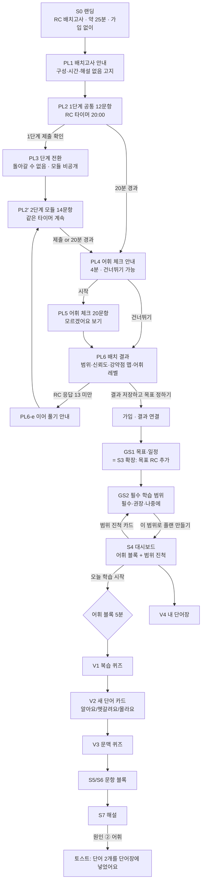

# S1-13 배치고사 · 필수 학습 범위 · 어휘(F11) 화면 설계

- 작성: UX/UI Designer / 보고 대상: Chief of Staff / 작성일: 2026-10-13 / 버전: v0.1 (스케치)
- 입력: `docs/specs/placement-and-vocab.md`(S1-12, 이하 "명세"), `docs/design/core-flow.md`(S0~S15, 디자인 원칙 D1~D7, 토큰), `prototypes/part7-split.html`(스타일 기준), `docs/research/competitors.md`, `docs/cs/competitor-complaints.md`(C1~C12)
- 프로토타입: `prototypes/placement-result.html` (배치고사 결과 → 목표 입력 → 필수/권장/나중에 범위 → 단어 카드·퀴즈 샘플, 외부 의존성 없음, 라이트/다크, 모바일 반응형). 스크린샷 `placement-result.png`(1280px), `placement-result-mobile.png`(390px).
- 표기: **[명세]** 명세 수용 기준을 화면에 옮긴 것 / **[제안]** 디자이너가 더한 것(승인 필요) / **[수정안]** 명세와 다르게 가자는 것(근거 포함) / **[미확인]** 경쟁사 사실 확인 전
- 이 문서가 core-flow를 바꾸는 곳: **S0**(문구), **S1·S2를 PL1~PL6으로 대체**, **S3를 GS1로 확장**, **GS2 신설**, **S4 대시보드에 어휘 블록·범위 진척 추가**, **V1~V4 신설**, S7 해설에 "단어장에 넣기" 추가. 디자인 원칙·토큰·컴포넌트는 core-flow 1장·6장을 그대로 쓴다.

---

## 0. 결론 요약

1. **새 화면 12개, 바뀌는 기존 화면 4개.** 흐름은 `S0 → PL1 안내 → PL2 1단계 → PL3 단계 전환 → PL2' 2단계 → PL4 어휘 체크 안내 → PL5 어휘 체크 → PL6 결과 → GS1 목표·일정 → GS2 필수 학습 범위 → S4 대시보드`. 어휘는 `S4 어휘 블록 → V1 복습 퀴즈 → V2 새 단어 카드 → V3 문맥 퀴즈`, 그리고 상시 `V4 내 단어장`.
2. **결과 화면(PL6)은 "숫자 하나" 대신 4줄로 말한다**: RC 범위(270~370, 중앙 320) · 베타 · 근거 26문항 · 신뢰도 "보통"과 이유. 신뢰도는 3칸 미터로 그리되 배치고사에서는 **"높음" 칸을 잠금 아이콘과 "모의고사 후 열려요"로 표시**해 왜 높음이 안 나오는지 보여 준다.
3. **강약점 맵은 대분류마다 "상태 + 근거 n문항"을 같이 쓴다** [수정안 R5]. "판단 보류"는 회색 점선 칸과 "근거 1문항 · 학습하면서 채워요"로 보이게 남긴다. 색만 쓰지 않고 모양(▼ 약점 · ● 보통 · ▲ 강점 · ? 보류)과 라벨을 같이 쓴다(D7).
4. **범위 화면(GS2)은 "무엇을 안 해도 되는지"가 핵심 차별점이다.** 필수 → 권장 → 나중에(기본 접힘) 순서, 단위마다 이유 한 줄 + 근거 칩 3개(자주 나와요 / 목표 400에 필요 / 내 약점) + 분량 + 배치 주차. P 점수(1~27)는 주 화면에 숫자로 쓰지 않고 "왜 이 순서인가요?" 펼침에서만 보인다. 맨 위 **용량 막대**(필수 285분 · 권장 75분 / 용량 375분)로 "다 할 수 있는 양인지"를 먼저 보여 준다.
5. **목표 입력은 별도 화면을 만들지 않고 기존 S3 플랜 설정 폼에 한 칸을 더한다** [수정안 R6]. 화면 수를 줄여 배치고사 뒤 "플랜까지" 클릭을 4회 이하로 유지한다(해커스형 단계 많은 동선 C9 회피).

---

## 1. 흐름

### 1.1 흐름도



### 1.2 화면 목록

| ID | 화면 | 기능 | core-flow와의 관계 | 와이어프레임 |
|---|---|---|---|---|
| S0 | 랜딩 | F1 | 문구·구성 줄만 변경 | |
| PL1 | 배치고사 안내 | F1 | 신규 (S1 앞) | |
| PL2 | 배치고사 풀이 (1단계 / 2단계) | F1, F3 | S1 대체 (레이아웃은 S5/S6 재사용) | 간단 |
| PL3 | 단계 전환 | F1 | 신규 | 간단 |
| PL4 | 어휘 체크 안내 | F1, F11 | 신규 | |
| PL5 | 어휘 체크 풀이 | F1, F11 | 신규 | 간단 |
| PL6 | 배치 결과 ★ | F1, F7 | S2 대체 | ●● PC·모바일 + 프로토타입 |
| GS1 | 목표·일정 | F2 | S3 확장 | 간단 |
| GS2 | 필수 학습 범위 ★ | F2 | 신규 | ●● PC·모바일 + 프로토타입 |
| S4+ | 대시보드 추가분 | F2, F11 | S4에 카드 2개 추가 | 부분 |
| V1 | 단어 복습 퀴즈 | F11 | 신규 | |
| V2 | 오늘의 단어 카드 | F11 | 신규 | ● + 프로토타입 |
| V3 | 문맥 퀴즈 (뜻 고르기 / 파생어 빈칸) | F11 | 신규 | 간단 + 프로토타입 |
| V4 | 내 단어장 | F11 | 신규 | 간단 |
| S7+ | 해설의 어휘 → 단어장 | F5, F11 | S7에 버튼·토스트 추가 | |

---

## 2. 화면별 명세

틀: **목적 / 주요 요소 / 상호작용 / 빈 상태·오류 상태 / 경쟁사 대비** (산타·해커스 중심. 경쟁사 사실은 competitors.md 표기를 그대로 따른다).

### S0. 랜딩 (변경분만)

- 주 버튼 문구: **"RC 배치고사 시작 · 약 25분 · 가입 없이"** [명세 1.7]. 구성 한 줄: "RC 26문항(2단계) + 어휘 20문항(건너뛸 수 있어요)".
- "이어 풀기" 배너 문구에 단계 표시: "2단계 6/14까지 풀었어요 · 이어 풀기".

### PL1. 배치고사 안내

- **목적**: 시작 전에 "무엇을, 얼마나, 어떤 규칙으로" 푸는지 30초 안에 알게 한다. 특히 1단계로 돌아갈 수 없다는 규칙을 미리 알린다(시험 중 놀람 방지).
- **주요 요소**
  - 구성 3줄 타임라인: ① 1단계 12문항 (권장 7분) ② 2단계 14문항 — 1단계 결과에 맞춰 난이도가 정해져요 (권장 13분) ③ 어휘 체크 20문항 · 4분 · 건너뛰기 가능.
  - 규칙 체크리스트(아이콘 + 텍스트): "RC는 20분 타이머 하나", "풀이 중에는 해설이 없어요", "1단계를 제출하면 1단계로 돌아갈 수 없어요", "창을 닫아도 24시간 안에 이어 풀 수 있어요".
  - 결과 미리보기 한 줄: "결과는 점수 하나가 아니라 범위와 근거로 보여 드려요(베타)".
  - 주 버튼 "1단계 시작", 보조 텍스트 버튼 "글자 크기 미리 정하기".
- **상호작용**: 주 버튼 → PL2 1번 문항, 타이머 시작. 로그인 회원이 이미 A폼을 풀었으면 "B폼으로 재배치(1회)" 안내로 대체 [명세 4.1-11].
- **빈·오류 상태**: 폼 로딩 실패 → "문항을 받지 못했어요 · 다시 시도"(타이머 시작 안 함). 재배치 기회 소진 → "재배치는 1회만 가능해요. 다음 예측은 모의고사로 갱신돼요" + 모의고사 링크.
- **경쟁사 대비**: 산타는 "12문항 · 3분 안에 성적 확인" [회사 주장]으로 짧음을 내세운다. 우리는 25분이 더 길다는 약점을 숨기지 않고 "왜 25분인지(범위·강약점 맵·어휘 레벨)"를 안내 화면에서 바로 설명한다. 해커스 빅플의 진단테스트 [사실]는 구성 안내 수준을 확인하지 못함 [미확인].

### PL2. 배치고사 풀이 (1단계 / 2단계)

- **목적**: 응답·문항별 시간을 모은다. 단계 구분이 헷갈리지 않게 한다.
- **주요 요소**: core-flow S1 상단 바를 쓰되 진행률을 두 줄로: 큰 글씨 "1단계 7/12", 작은 글씨 "전체 7/26". RC 남은 시간 하나(20:00부터). 1단계에서는 남은 시간 옆에 **페이스 안내** "권장 7분 중 4:10 사용"(경고 색 아님, 정보) [명세 1.3]. 본문은 Part 5 → S5, Part 6·7 → S6 레이아웃. 문항 목록 서랍은 **현재 단계 문항만** 보여 준다(1단계 제출 후 1단계 칸은 잠금 아이콘).
- **상호작용**: 단계 안에서는 자유 이동·답 변경. 1단계 마지막 문항에서 하단 주 버튼이 "1단계 제출"로 바뀐다(다음 문항 버튼과 색·아이콘·위치 다름, D5). 2단계 마지막 문항은 "RC 제출". 해설 없음.
- **빈·오류 상태**: 오프라인 → 로컬 저장 배지(core-flow S1 그대로). 1단계 중 20분 경과 → 자동 제출, "시간이 끝나 1단계 응답으로 채점해요" 안내 후 PL4 [명세 4.1-3]. 2단계 모듈 로딩 실패 → PL3에서 재시도(타이머 일시정지, 정지 시간은 결과에 "일시정지 n초"로 기록 [제안]).
- **경쟁사 대비**: 산타의 "빨리 풀면 경고 후 미반영"(C6) 대신 빠른 응답은 반영하고 결과에서 공개한다(core-flow R4 유지).

### PL3. 단계 전환

- **목적**: 1단계를 끝냈다는 확인과 "되돌아갈 수 없음"을 한 번 더 확인받고, 2단계로 끊김 없이 넘어간다.
- **주요 요소**
  - 확인 시트(PL2 위에 뜨는 바텀시트/모달): "1단계를 제출할까요? 제출하면 1단계로 돌아갈 수 없어요" [명세 4.1-2], 안 푼 문항이 있으면 "안 푼 문항 2개(3번, 9번)" + 각 번호 바로가기. 버튼: 보조 "계속 풀기", 주 "제출하고 2단계로".
  - 전환 화면(약 2초, 또는 사용자가 누를 때까지): "1단계 완료 ✓ · 2단계 14문항 · 남은 시간 13:20". **어느 모듈인지(기초/중간/상위)와 1단계 정답 수는 보여 주지 않는다** [명세 4.1-2]. 문구: "1단계 결과에 맞춰 문제를 골랐어요. 어렵게 느껴져도 정상이에요."
- **상호작용**: 타이머는 전환 화면에서도 흐른다(단일 RC 타이머). 그래서 자동 넘김 2초 + "바로 시작" 버튼. 스크린리더에 전환 문구를 `aria-live="assertive"`로 1회.
- **빈·오류 상태**: 1단계 0문항 응답으로 제출 시도 → 확인 시트에 "아직 한 문항도 안 풀었어요" + 제출 버튼 비활성 아님(사용자 통제) [제안]. 분기 계산·모듈 로딩 실패 → "2단계를 준비하지 못했어요 · 다시 시도", 타이머 일시정지.
- **경쟁사 대비**: 산타·해커스 모두 단계형 진단 여부를 확인하지 못함 [미확인]. "어려워져도 정상" 문구는 적응형 진단에서 흔한 "내가 망쳤나" 불안을 줄이는 장치다.

### PL4. 어휘 체크 안내

- **목적**: RC를 끝낸 피로 상태에서 4분짜리 선택 과제를 할지 스스로 고르게 한다.
- **주요 요소**: "RC 끝! 어휘 체크 4분이 남았어요", 효과 한 줄 "내 수준에 맞는 단어부터 추천해 드려요", 규칙 2줄 "모르면 '모르겠어요'를 골라 주세요 · 찍으면 너무 어려운 단어부터 나와요", "어휘 체크는 RC 점수에 들어가지 않아요" [명세 1.4]. 주 버튼 "어휘 체크 시작 · 4분", 보조 버튼(외곽선, **같은 크기**) "건너뛰고 결과 보기".
- **상호작용**: 건너뛰기 → PL6, 어휘 레벨은 "간이 추정(RC 어휘 문항 기준)" [명세 4.1-4].
- **빈·오류 상태**: RC 자동 제출로 넘어온 경우 상단 정보 배너 "시간이 끝나 RC를 자동 제출했어요(응답 21/26)".
- **경쟁사 대비**: 다크 패턴 없이 건너뛰기를 주 버튼과 같은 크기로 둔다(core-flow S15 해지 설문과 같은 원칙).

### PL5. 어휘 체크 풀이

- **목적**: 레벨별 5단어로 "어디서부터 단어를 시작할지"를 4분 안에 잰다.
- **주요 요소**: 상단 "어휘 12/20 · 3:02" (별도 4분 타이머). 문항: 비즈니스 구 속 굵은 표제어("**postpone** the quarterly meeting", `lang="en"`), 보기 4개 + 구분선 아래 **"⑤ 모르겠어요"**(점선 테두리, 회색 텍스트 — 오답과 같은 취급이지만 "포기"가 아니라 정직한 답으로 보이게) [제안]. 레벨 표시는 하지 않는다(쉬운 문항에서 긴장 유발 방지).
- **상호작용**: **보기를 누르면 바로 다음 문항**(문항당 평균 12초, 채점 버튼 없음) [제안 — 4분 20문항은 "고르기 → 채점" 2단계로는 빠듯함]. 대신 "← 이전" 으로 돌아가 바꿀 수 있다. 키보드 1~5. 4분 경과 → 자동 종료, 안 푼 문항은 "모르겠어요"로 처리하고 결과에 "안 푼 어휘 문항 n개" 표시.
- **빈·오류 상태**: 응답 10개 미만으로 종료 → 어휘 레벨 "간이 추정(RC 어휘 문항 기준)"으로 대체 + "어휘 체크를 다시 하려면 내 단어장 → 레벨 다시 재기" [제안].
- **경쟁사 대비**: 산타 앱은 "단어 2,000개" [회사 주장]를 내세우지만 시작 레벨 측정 방식은 확인하지 못함 [미확인]. 해커스 보카 계열 앱의 레벨 측정 여부도 [미확인] — market-researcher 확인 대기(명세 5.4).

### PL6. 배치 결과 ★ (S2 대체)

- **목적**: "지금 RC가 어디쯤이고(범위), 얼마나 믿을 수 있고(신뢰도), 무엇이 약하며(맵), 단어는 어디서 시작하는지(레벨)"를 한 화면에서 이해시키고 **목표 입력**으로 넘긴다.
- **주요 요소** (위 → 아래 = 중요도)
  1. **RC 범위 카드**: 0~495 축 위 범위 띠(270~370)와 중앙값 점(320), 숫자 라벨 "RC 270~370 · 중앙 320". 라벨 칩 **"베타"**, "근거 26문항". 트랙 목표선(400)을 점선으로. 스크린리더 텍스트 "예측 RC 270점에서 370점, 중앙값 320점" [명세 4.1-6].
  2. **신뢰도 미터**: 3칸(낮음 · 보통 · 높음). 보통까지 채움, "높음" 칸은 잠금 아이콘 + "모의고사 후 열려요". 이유 한 줄: "응답 26문항 · 빨리 푼 문항 2개 · 2단계 정답률 정상 범위" / 범위를 좁히는 법: "모의고사를 보면 ±25까지 좁아져요" [명세 1.5, 1.6]. 낮음일 때는 이유 문구가 경고 색 + ⚠로 바뀌고 반폭이 ±60 [명세 4.1-8].
  3. **배정 트랙 카드**: "300→400 트랙 추천" + 경로 설명 한 줄 "1단계 12문항 중 5개 → 기초 모듈" (응시 후에만 공개) [명세 4.1-2]. 경계(390~405)면 "두 트랙 경계예요" + 선택권(architecture 7.1).
  4. **유형별 강약점 맵** (대분류 8칸 그리드, PC 4열 · 모바일 2열): 칸마다 대분류 이름, 상태(▼ 약점 / ● 보통 / ▲ 강점 / ? 판단 보류), **근거 n문항** [수정안 R5]. 정렬: 약점 → 보통 → 강점 → 판단 보류. 판단 보류 칸은 점선 테두리 + "근거 1문항 · 학습하면서 채워요" [명세 4.1-7].
  5. **어휘 레벨 카드**: 레벨 계단 4칸(기초 ✓ 5/5 · 400 ✗ 2/5 · 450 1/5 · 495 0/5) + 결론 "400 레벨부터 시작 (간이 추정)". 퍼센트는 쓰지 않는다 [명세 4.1-5]. 건너뛴 경우 "간이 추정(RC 어휘 문항 3개 기준)".
  6. **시간**: "10초 안에 답한 문항 2개 · 시간 안에 못 푼 문항 0개".
  7. 주 버튼 **"목표 정하고 필수 범위 보기"** (비회원: "결과 저장하고 목표 정하기"). 보조 텍스트 링크 "이 결과는 어떻게 계산되나요?"(접힘).
- **상호작용**: 맵 칸을 누르면 그 대분류에서 푼 문항 목록(정오 + 해설 보기 — 배치고사 해설은 결과 후 공개)을 시트로 [제안]. 판단 보류 칸을 누르면 "근거가 2문항 미만이라 판단하지 않았어요" 설명. 신뢰도 ⓘ → 1.6 규칙을 쉬운 말 표로.
- **빈·오류 상태**
  - RC 응답 13문항 미만 → 범위·맵 자리를 비우고 "판정하기에 응답이 부족해요(9/26) · 이어 풀면 결과가 나와요" + 이어 풀기 [명세 4.1-9]. 어휘 카드는 있으면 보여 준다.
  - 신뢰도 낮음 → 범위 띠를 빗금 패턴으로(색만이 아니라 패턴으로 "불확실"을 표시) + 이유 문구.
  - 하한 450 이상 → core-flow S2 규칙(대기 등록 + 400→450 고난도) 유지.
  - 결과 계산 실패 → 응답은 저장됨을 먼저 말하고 "결과 계산을 다시 시도하는 중" + 수동 재시도.
- **경쟁사 대비**: 산타는 12문항 진단으로 **예측 점수 한 숫자** [회사 주장]. 우리는 범위·근거 수·신뢰도·"판단 보류"까지 공개한다(C6 "예상 점수가 후하다" 대응). 해커스 빅플 진단은 예상점수·취약 문제를 준다 [사실]. 우리는 취약 "문제"가 아니라 **유형 대분류별 상태와 근거 수**를 주고, 어휘 수준을 따로 잰다.

### GS1. 목표·일정 (S3 확장) [수정안 R6]

- **목적**: 범위 계산에 필요한 입력 4개(목표 RC · 시험일 · 하루 시간 · 필요 이유)를 한 화면에서 받는다.
- **주요 요소**: core-flow S3 폼 맨 위에 **① 목표 RC** 추가 — 숫자 입력(5점 단위, `inputmode="numeric"`) + −/+ 스테퍼(5점) + 트랙 상단 값(400) 미리 채움 [명세 4.2-1]. 그 아래 접힘 "총점 목표로 계산하기": 총점 목표, 최근 LC → "필요한 RC = 총점 − LC" 자동 계산 후 "이 값 쓰기" 버튼. LC를 모르면 참고 문구만("한국 평균은 LC가 RC보다 약 70점 높아요 · 참고용") — 값을 대신 넣지 않는다 [명세 2.1]. 이어서 기존 ② 시험일 ③ 하루 시간 ④ 이유. 하단 미리보기에 "필요 상승폭 +80 (중앙 320 기준) · 주당 약 13점".
- **상호작용**: 값이 바뀌면 미리보기 즉시 갱신. 주 버튼 "필수 학습 범위 보기" → GS2.
- **빈·오류 상태**
  - (목표 − 중앙값) ÷ 남은 주 > 15 → 노란 배너 "⚠ 도전적인 목표예요. 베타 데이터로 확인된 기준이 아니라 참고용이에요" + 다음 시험일 칩 2개. **저장은 막지 않는다** [명세 4.2-2].
  - 목표 ≤ 현재 중앙값 → "이미 목표 근처예요. 목표를 올리거나 유지 플랜으로 시작할 수 있어요" [제안].
  - 5점 단위 아님·5~495 밖 → 필드 아래 오류 문구 + 아이콘.
- **경쟁사 대비**: 산타 기간권(30/90일)·패키지 선택(C3) 대신 시험일·목표에서 거꾸로 계산한다. 해커스 빅플 40/70/100일 상품 [사실]도 기간이 상품에 고정되어 있다.

### GS2. 필수 학습 범위 ★

- **목적**: "내 목표 점수까지 **꼭 해야 할 것 / 시간 되면 할 것 / 이번엔 안 해도 되는 것**"을 이유와 함께 보여 주고, 그대로 플랜으로 넘긴다.
- **주요 요소**
  1. 요약 헤더: "현재 RC 270~370(중앙 320) → 목표 400 · 6주 · 하루 25분". 오른쪽 "목표·일정 바꾸기" 텍스트 버튼.
  2. **용량 막대**: 신규 학습 용량 375분 안에 필수 285분(진한 색) + 권장 75분(옅은 색 + 빗금) + 남는 15분. 아래 한 줄: "필수 9개(+ 어휘 매일)는 모두 기간 안에 들어가요. 권장 5개 중 2개도 들어가요." 어휘는 "매일 5분 · 별도"로 막대 밖에 표시(명세 2.5 용량 계산과 일치). "용량은 어떻게 계산하나요?" 접힘 → 750분 − 어휘 150 − 모의고사 100 − 복습 25% = 375.
  3. **탭 대신 세 묶음 세로 나열**: 필수(10) → 권장(5) → 나중에(4, 기본 접힘 [명세 Q-P8 (a)]). 모바일에서도 같은 순서(탭으로 숨기면 "나중에"의 존재를 모른다).
  4. **단위 행**: 순서 번호 · 단위 이름(한국어) + 태그 코드(작게, 보조) · 이유 한 줄 · 근거 칩 3개(빈도: "자주 나와요/가끔/드물어요" · 목표 기여: "목표 400에 필요/일부/거의 안 필요" · 내 상태: "약점/보통·아직 모름/강점") · 분량(30분/45분/매일 5분) · 배치("1주"/"시간 남으면"). **"+N점" 표시 없음** [명세 2.3-4, 4.2-3]. 빈도는 말로만, 수치 없음 [명세 가정 5].
  5. 필수 맨 위에 **어휘 400 레벨** 행을 고정(⟳ 매일 아이콘).
  6. 권장 중 용량 밖 행은 "시간 남으면" 회색 칩. "유지" 단위(강점이지만 자주 나옴)는 "권장 · 유지(복습만)" 표시 [명세 2.3 보정 1].
  7. "나중에" 행: 이유("목표 400에서는 대부분 틀려도 되는 고난도 유형이에요" / "드물게 나와요") + 보조 버튼 "플랜에 넣기".
  8. 하단 고정 바: 주 버튼 **"이 범위로 6주 플랜 만들기"**, 보조 "주차별로 보기"(1~6주 타임라인으로 전환).
- **상호작용**
  - 행을 펼치면: 이 단위에서 내가 푼 문항 수·정답률, 유형 카드 미리보기, "왜 이 순서인가요?" — F·C·W 3칸과 P값(예: 3×3×3=27)을 여기서만 숫자로 보여 준다 [제안: P값은 설명 계층에만].
  - "나중에 → 플랜에 넣기": 용량 안이면 권장 끝에 들어가고 토스트. 용량을 넘으면 확인 시트 "이걸 넣으면 '비교·최상급'이 시간 남으면으로 밀려요 · 넣기 / 취소" [명세 4.2-5].
  - 기간 부족으로 강등이 생기면 용량 막대 위 정보 배너 "기간이 짧아 필수 범위 중 2개를 권장으로 옮겼어요 · 어떤 것?" + 강등된 행에 "↓ 필수에서 옮김" 라벨 [명세 4.2-4]. 프로토타입에서 6주/4주 전환으로 재현.
  - 재계산으로 분류가 바뀌면(세션 30문항마다·모의고사 후) 대시보드와 이 화면 상단에 한 줄 기록 "10/27 시제 정답률 85% → 완료, 필수에서 뺐어요" [명세 4.2-7]. 완료 단위는 필수 묶음 안에서 ✓ + 취소선 없이 "완료 · 복습만"으로 [명세 4.2-8].
- **빈·오류 상태**
  - 배치고사 없이 진입(직접 URL·재방문) → "배치고사를 보면 내 약점까지 반영한 범위가 나와요" + 트랙 기본 범위(W=2로 계산)를 "기본 범위"로 표시.
  - 필수 0개(목표가 현재와 같거나 낮음) → "필수 범위가 없어요 · 유지 복습 플랜을 추천해요".
  - 콘텐츠 부족(F=3 단위 안 푼 문항 15개 미만) → 해당 행에 "문항 준비 중 · 3주 차부터 열려요" [명세 2.6 콘텐츠 조건].
  - 계산 실패 → 직전 스냅숏 표시 + "갱신 실패 · 시각".
- **경쟁사 대비**: 해커스는 강의·교재 "범위 전체"를 커리큘럼으로 준다(메뉴·상품 복잡, C9). 산타는 AI가 다음 문항을 골라 주지만 **왜 그 범위인지·무엇을 안 해도 되는지**를 보여 준다는 근거를 찾지 못함 [미확인]. 우리는 "안 해도 되는 범위"를 이유와 함께 공개하는 것이 차별점이다.

### S4+. 대시보드 추가분

- **오늘 카드 구성 줄**: "어휘 5분(복습 9 · 새 단어 12) · 문항 20분(Part 5 8 · Part 7 1세트)" — 두 블록 합이 설정 시간과 같다 [명세 4.4 F2]. 주 버튼은 여전히 1개 "오늘 학습 시작"(어휘 블록부터 시작, D1).
- **필수 범위 진척 카드**(졸업 조건 카드 위): "필수 범위 4 / 10 완료" 막대 + 이번 주 단위 이름 2~3개 + "범위 전체 보기 →"(GS2) [명세 2.6].
- **어휘 카드**(이번 주 카드 옆): "익힌 단어 132 · 오늘 복습 9 · 400 레벨 132 / 450" [명세 4.3-10] + "내 단어장 →".
- 빈 상태: 어휘 체크·플랜 없음 → 어휘 카드에 "플랜을 만들면 매일 단어가 여기 나와요".

### V1. 단어 복습 퀴즈 (어휘 블록 1단계)

- **목적**: 오늘 복습 예정(1·3·7·14일 단계) 카드를 문맥 퀴즈로 빠르게 확인한다. 복습이 신규보다 먼저 온다(기억 곡선상 우선).
- **주요 요소**: 상단 "어휘 · 복습 3/9 · 남은 약 4분", 퀴즈 본문(V3와 같은 컴포넌트), 단계 칩 "7일 복습".
- **상호작용**: 정답 → "✓ 정답 · 다음 복습 14일 뒤" 0.8초 후 다음. 오답 → "✗ 오답 · 내일 다시 나와요"(1일 단계로) + 카드 요약(뜻·예문) 펼침 + "다음" 버튼 [명세 4.3-3].
- **빈·오류 상태**: 복습 0개 → V2로 바로. 복습 예정 40개 초과 → 상단 정보 배너 "복습이 많아 오늘 새 단어는 4개만 나와요" [명세 4.3-7]. 어휘 블록 시간이 다 되면 "오늘 어휘 시간 끝 · 남은 복습 6개는 내일로" + "더 하기(선택)".
- **경쟁사 대비**: 별도 단어 앱으로 이동하지 않는다(해커스형 교재·앱 분리 동선 C5와 같은 원리, D2).

### V2. 오늘의 단어 카드 (첫 노출 거르기)

- **목적**: 새 카드 1장을 10초 안에 판단하고(알아요/헷갈려요/몰라요), 모르는 단어만 깊게 본다.
- **주요 요소** (앞면 → 펼침)
  - 앞면: 표제어(크게, `lang="en"`), 품사 칩, 레벨 칩("400"), 출처 칩("오답에서" / "필수 범위: 품사 자리" / "레벨 단어"), 토익 맥락 예문(표제어 굵게), 버튼 3개 **알아요 / 헷갈려요 / 몰라요**(같은 크기, 색 대신 아이콘 ✓ ? ✗ + 텍스트).
  - 펼침(헷갈려요·몰라요 또는 "뜻 보기"): 뜻(대표 1 + 보조 1), 예문 번역, 콜로케이션 2~4, 파생어 표(품사별 — P5 품사 자리 연결 아이콘), 혼동어 한 줄(있으면), 패러프레이즈(있으면), 출제 유형 이름("Part 5 어휘 · Part 7 동의어"), "이 단어가 나온 문제 보기 (2)" [명세 4.3-6], ⋯ → 오류 신고 [명세 4.3-9].
- **상호작용**: 알아요 → V3 확인 퀴즈 1개 → 맞히면 "아는 단어로 표시 · 14일 뒤 한 번만 확인", 틀리면 "신규 학습으로 돌아가요" + 펼침 [명세 4.3-2]. 헷갈려요·몰라요 → 펼침 → "다음 단어" → 블록 끝에 V3 퀴즈. 키보드: 1/2/3, Space 뒤집기. 모바일은 좌우 스와이프 금지(오조작) — 버튼만 [제안].
- **빈·오류 상태**: 신규 0(레벨 소진) → "400 레벨 450개를 다 봤어요 · 450 레벨로 넘어갈까요?". 간이 카드(마스터에 없는 오답 단어) → "간이 카드 · 문항 문장을 예문으로 써요" 라벨, 파생어 칸 숨김. 카드 로딩 실패 → 건너뛰고 끝에 재시도.
- **경쟁사 대비**: 산타 "단어 2,000개" [회사 주장]처럼 목록 크기를 내세우지 않고, **내 오답·내 필수 범위에서 왔다는 출처 칩**으로 "왜 이 단어인지"를 보여 준다. 해커스 보카 계열과 달리 별도 앱·교재 없이 같은 세션 안에서 끝난다 [해커스 보카 기능 상세는 미확인].

### V3. 문맥 퀴즈 (MVP 2종)

- **목적**: 뜻 암기가 아니라 **토익 문장 안에서 쓸 수 있는지**를 확인한다.
- **주요 요소**
  - ① 문맥 뜻 고르기: 예문 + 밑줄 표제어 + 한국어 뜻 4지선다.
  - ② 파생어 빈칸: Part 5 형식 문장 + 같은 어족 4개 보기(예: reimburse / reimbursement / reimbursable / reimbursed). 상단 라벨 "Part 5 품사 자리 연습" — 범위의 필수 단위(P5-POS)와 연결된다는 걸 말로 보여 준다 [명세 3.4-4].
  - 보기는 core-flow AnswerOption 컴포넌트 재사용. 채점 즉시(Part 5와 같음), 해설 한 줄("빈칸 앞 'receive' 뒤는 목적어 자리 → 명사").
- **상호작용**: 보기 선택 → 즉시 채점(퀴즈는 짧아서 채점 버튼을 생략하고, "확신 없음" 토글도 두지 않는다) [제안]. 결과 줄(✓/✗ + 해설 한 줄) → "다음" 버튼.
- **빈·오류 상태**: 템플릿이 유효 오답 보기 3개를 못 만들면 그 퀴즈는 ①로 대체(정답 둘 방지 규칙, 명세 4.3-8 — qa 검수 대상).
- **경쟁사 대비**: 뜻 매칭 위주 단어장 앱과 달리 Part 5 형식 파생어 문제로 문항 풀이와 바로 이어진다.

### V4. 내 단어장

- **목적**: 지금까지 모인 단어를 출처·단계별로 보고, 직접 관리한다.
- **주요 요소**: 상단 요약(익힌 단어 · 학습 중 · 오늘 복습 · 현재 레벨 진척 132/450), 필터 칩(전체 / 오답에서 / 직접 넣음 / 아는 단어 / 익힘), 정렬(다음 복습일 / 최근 추가), 행(표제어 · 뜻 · 단계 점 5개 ●●●○○ · 다음 복습 "3일 뒤" · 출처 아이콘), 검색. 보조: "레벨 다시 재기"(B폼 재배치 때 같이 — 명세 3.5).
- **상호작용**: 행 → V2 펼침 카드(읽기 모드). 행 ⋯ → "이 단어 빼기"(익힘 처리·복습 중단) / "처음부터 다시". 오답에서 온 단어는 "이 단어가 나온 문제" 링크.
- **빈·오류 상태**: 0개 → "첫 세션을 하면 단어가 여기 모여요. 틀린 문제의 어휘도 자동으로 들어와요." 필터 결과 0 → "조건에 맞는 단어가 없어요 · 필터 지우기".
- **경쟁사 대비**: 해커스형 "레벨별 Day 목록" 단어장 [미확인]과 달리 **출처(오답·필수 범위)** 기준으로 묶여, 내가 왜 이 단어를 보는지 알 수 있다.

### S7+. 해설의 어휘 → 단어장 (core-flow S7 변경분)

- 해설 "어휘 2~5개" 각 행에 "+ 단어장" 버튼(누르면 "✓ 넣음"으로 바뀜, 다음 날 신규 맨 앞 [명세 4.3-5]).
- 오답 원인 ② 어휘가 선택된 채 해설을 닫으면 토스트 "단어 2개를 단어장에 넣었어요 · 보기 · 되돌리기" [명세 4.3-4]. 하루 5개 초과 → "오늘은 5개까지 넣었어요. 나머지 1개는 내일 넣을게요".

---

## 3. 와이어프레임 (ASCII)

### 3.1 PL6 배치 결과 — PC 1280px

```
┌────────────────────────────────────────────────────────────────────────────┐
│ [로고]  배치고사 결과                                  [베타] ⓘ   [저장]    │
├────────────────────────────────────────────────────────────────────────────┤
│  지금 내 RC                                         ┌─ 신뢰도 ───────────┐ │
│   RC 270 ~ 370   중앙 320              [베타]       │ [■■■■][■■■■][🔒  ] │ │
│                                                     │  낮음   보통   높음  │ │
│   0 ──────────────[▓▓▓▓▓●▓▓▓▓▓]──────┆──────── 495  │ 보통 · 응답 26문항  │ │
│                    270  320  370    목표 400        │ 빨리 푼 문항 2개    │ │
│   근거 26문항 (1단계 12 + 2단계 14) · 10초 안 답 2개 │ 모의고사 후 ±25까지 │ │
│                                                     └────────────────────┘ │
├────────────────────────────────────────────────────────────────────────────┤
│  추천 트랙  300→400       경로: 1단계 12문항 중 5개 → 기초 모듈 14문항     │
├────────────────────────────────────────────────────────────────────────────┤
│  유형별 강약점 (대분류)                ▼약점 ●보통 ▲강점 ?판단 보류        │
│  ┌──────────────┐┌──────────────┐┌──────────────┐┌──────────────┐          │
│  │▼ 품사 자리    ││▼ 동사         ││▼ Part 5 어휘  ││● 연결어       │          │
│  │  약점 · 근거 2││  약점 · 근거 3││  약점 · 근거 3││  보통 · 근거 3│          │
│  └──────────────┘└──────────────┘└──────────────┘└──────────────┘          │
│  ┌──────────────┐┌──────────────┐┌──────────────┐┌┈┈┈┈┈┈┈┈┈┈┈┈┈┈┐          │
│  │● Part 6 문맥  ││● P7 세부 정보 ││▲ P7 주제·목적 │┆? 기타 문법    ┆          │
│  │  보통 · 근거 4││  보통 · 근거 6││  강점 · 근거 4│┆ 근거 1 · 보류 ┆          │
│  └──────────────┘└──────────────┘└──────────────┘└┈┈┈┈┈┈┈┈┈┈┈┈┈┈┘          │
├───────────────────────────────────────┬────────────────────────────────────┤
│  어휘 레벨 (간이 추정)                  │ 다음 단계                           │
│  기초 ✓5/5 → 400 ✗2/5 → 450 1/5 → 495 0│ 목표 점수를 정하면 꼭 해야 할 범위와 │
│  ▶ 400 레벨부터 시작                    │ 안 해도 되는 범위를 알려 드려요.     │
│  ※ RC 점수에는 들어가지 않아요          │ ┌──────────────────────────────┐   │
│                                        │ │ 목표 정하고 필수 범위 보기 →  │   │
│                                        │ └──────────────────────────────┘   │
│                                        │ 이 결과는 어떻게 계산되나요? ▸      │
└───────────────────────────────────────┴────────────────────────────────────┘
```

### 3.2 PL6 배치 결과 — 모바일 390px

```
┌──────────────────────────────┐
│ ← 배치고사 결과        [베타] │
├──────────────────────────────┤
│ 지금 내 RC                    │
│ RC 270~370  중앙 320          │
│ 0 ───[▓▓●▓▓]──┆── 495         │
│          목표 400             │
│ 근거 26문항                   │
│ 신뢰도 [■■][■■][🔒] 보통      │
│ 모의고사 후 ±25까지 좁아져요  │
├──────────────────────────────┤
│ 추천 300→400 · 기초 모듈 경로 │
├──────────────────────────────┤
│ 유형별 강약점                 │
│ ┌────────────┐┌────────────┐ │
│ │▼ 품사 자리  ││▼ 동사       │ │
│ │ 약점 · 2    ││ 약점 · 3    │ │
│ └────────────┘└────────────┘ │
│ ...(2열 × 4행)                │
├──────────────────────────────┤
│ 어휘: 400 레벨부터 (간이 추정) │
├──────────────────────────────┤
│ ┌──────────────────────────┐ │ ← 하단 고정
│ │ 목표 정하고 필수 범위 보기 │ │
│ └──────────────────────────┘ │
└──────────────────────────────┘
```

### 3.3 GS2 필수 학습 범위 — PC 1280px

```
┌────────────────────────────────────────────────────────────────────────────┐
│ ← 결과   필수 학습 범위                                   [목표·일정 바꾸기] │
├────────────────────────────────────────────────────────────────────────────┤
│ 현재 RC 270~370 (중앙 320) → 목표 400 · 6주 · 하루 25분                     │
│                                                                            │
│ 6주 동안 새로 배울 시간 375분                     어휘는 매일 5분 · 별도     │
│ [██████████████████████████████████▒▒▒▒▒▒▒▒▒░░]                            │
│  필수 285분                         권장 75분  남음 15                      │
│ 필수 9개(+어휘)는 모두 들어가요. 권장 5개 중 2개도 들어가요. 용량 계산 ▸       │
├────────────────────────────────────────────────────────────────────────────┤
│ ■ 필수 10 — 목표 400에 직접 걸리고 지금 약하거나 아직 모르는 범위            │
│  ⟳ 어휘 400 레벨          약점·자주 나와요·목표에 필요     매일 5분  1~6주   │
│  1 품사 자리: 명사·동사    [자주 나와요][목표 400에 필요][약점]  30분  1주   │
│    배치고사 품사 2문항 중 0개 · 빈칸 앞뒤로 자리를 고르는 유형  ▸ 펼치기     │
│  2 품사 자리: 형용사·부사  [자주][목표에 필요][약점]           30분  1주   │
│  3 시제                    [자주][목표에 필요][약점]           30분  1주   │
│  5 수 일치 · 6 능동·수동 · 7 전치사 vs 접속사                  각 30분 2주  │
│  8 Part 7 세부 사항·수치   [자주][목표에 필요][보통]           45분  3주   │
│  9 to부정사·동명사·분사 · 10 Part 6 문맥 시제·접속부사         각 30분 3주  │
├────────────────────────────────────────────────────────────────────────────┤
│ □ 권장 5 — 시간이 되면 점수에 보탬                                          │
│  11 관계사 [가끔][일부 필요][보통]                              30분  4주   │
│  12 Part 7 추론                                                45분  4주   │
│  13 비교·최상급 · 14 NOT·TRUE                         [시간 남으면]         │
│  15 Part 7 주제·목적 (유지) [자주][목표에 필요][강점]  복습만 [시간 남으면]  │
├────────────────────────────────────────────────────────────────────────────┤
│ ▸ 나중에 4 — 이번 목표에선 효율이 낮아요 (펼치기)                           │
│    16 Part 6 문장 삽입 — 목표 400에서는 대부분 틀려도 되는 고난도  [플랜에 넣기]│
│    17 이중·삼중 연계 · 18 채팅 의도 파악 · 19 도치·가정법                    │
├────────────────────────────────────────────────────────────────────────────┤
│                          [주차별로 보기]  [ 이 범위로 6주 플랜 만들기 → ]   │
└────────────────────────────────────────────────────────────────────────────┘
```

### 3.4 GS2 — 모바일 390px

```
┌──────────────────────────────┐
│ ← 필수 학습 범위    [바꾸기]  │
├──────────────────────────────┤
│ 320 → 목표 400 · 6주 · 25분   │
│ [█████████████▒▒▒░] 375분     │
│ 필수 285 · 권장 75 · 남음 15  │
├──────────────────────────────┤
│ ■ 필수 10                     │
│ ┌──────────────────────────┐ │
│ │ 1 품사 자리: 명사·동사     │ │
│ │ 30분 · 1주                │ │
│ │ [자주][목표에 필요][약점]  │ │
│ │ 배치고사 2문항 중 0개 ▸    │ │
│ └──────────────────────────┘ │
│ ...                           │
│ □ 권장 5                      │
│ ▸ 나중에 4 (접힘)             │
├──────────────────────────────┤
│ [ 이 범위로 6주 플랜 만들기 ] │ ← 하단 고정
└──────────────────────────────┘
```

### 3.5 V2 단어 카드 (모바일 기준, PC는 가운데 560px 카드)

```
┌──────────────────────────────┐
│ 어휘 · 새 단어 4/12 · 약 3분  │
├──────────────────────────────┤
│ [v.] [400] [필수: Part 5 어휘]│
│                               │
│        postpone               │
│                               │
│ Harlow Logistics **postponed**│
│ the quarterly meeting until   │
│ the CFO returns.              │
│                     뜻 보기 ▾ │
├──────────────────────────────┤
│ [✓ 알아요][? 헷갈려요][✗ 몰라요]│
└──────────────────────────────┘
```

### 3.6 PL3 단계 전환 · PL5 어휘 체크 (간단)

```
PL3 확인 시트                          PL5 어휘 체크
┌──────────────────────────────┐      ┌──────────────────────────────┐
│ 1단계를 제출할까요?           │      │ 어휘 12/20          ⏱ 3:02   │
│ 제출하면 1단계로 돌아갈 수     │      │ "postpone the quarterly       │
│ 없어요.                       │      │  meeting"                     │
│ 안 푼 문항 2개: [3] [9]        │      │ [① 연기하다] [② 준비하다]     │
│ [계속 풀기]  [제출하고 2단계로]│      │ [③ 참석하다] [④ 발표하다]     │
└──────────────────────────────┘      │ ┈┈┈┈┈┈┈┈┈┈┈┈┈┈┈┈┈┈┈┈┈┈┈┈┈     │
                                      │ [⑤ 모르겠어요]  (점선)        │
                                      │ ← 이전                        │
                                      └──────────────────────────────┘
```

---

## 4. 디자인 시스템 추가분

core-flow 6장 토큰·컴포넌트를 그대로 쓰고 아래만 더한다. 프로토타입 `placement-result.html`에 같은 이름으로 들어 있다.

### 4.1 토큰 추가

| 토큰 | 라이트 | 다크 | 용도 |
|---|---|---|---|
| `--color-weak` | #C2362F (= wrong) | #FF8A80 | 강약점 "약점" (▼ + 라벨과 함께) |
| `--color-weak-bg` | #FCE8E6 | #3A1A18 | 약점 칸 배경 |
| `--color-mid` | #5A6270 (= text-muted) | #A3AAB5 | "보통" (● + 라벨) |
| `--color-strong` | #1E7F4F (= correct) | #5FD39A | "강점" (▲ + 라벨) |
| `--color-strong-bg` | #E3F4EA | #15301F | 강점 칸 배경 |
| `--color-hold` | 점선 `--color-border` + text-muted | 동일 | "판단 보류" (? + 점선 테두리) |
| `--color-tier-must` | #2F5BEA (= primary) | #7A9BFF | 필수 묶음 표시·용량 막대 |
| `--color-tier-rec` | #2F5BEA @ 35% + 빗금 | #7A9BFF @ 40% + 빗금 | 권장 |
| `--color-tier-later` | text-muted | text-muted | 나중에 |
| `--color-beta` | #6B4FD8 | #B9A6FF | "베타" 라벨 칩 (함정색 `--color-trap`과 구분되는 보라) |

> 약점=빨강·강점=초록은 정답/오답 색과 겹친다. 의미가 같은 방향(나쁨/좋음)이라 재사용하되, **항상 ▼▲ 모양 + 텍스트 라벨**을 같이 쓴다(D7). 사용성 테스트에서 "약점 = 틀렸다는 비난"으로 읽히면 약점을 주황(warning)으로 바꾸는 안을 B안으로 둔다.

### 4.2 컴포넌트 추가

| 컴포넌트 | 상태 |
|---|---|
| ConfidenceMeter (3칸) | 낮음·보통·(높음 잠금) / 판정 안 함 |
| RangeBar (기존) | + 목표선 · 빗금(신뢰도 낮음) 변형 |
| StrengthTile | 약점·보통·강점·판단 보류 · 포커스 · 눌림(시트 열림) |
| VocabLevelSteps | 통과·미통과·시작 레벨 강조·간이 추정 |
| CapacityBar | 여유·꽉 참·초과(강등 배너 동반) |
| ScopeUnitRow | 필수·권장·권장(유지)·시간 남으면·나중에·완료·"필수에서 옮김"·펼침 |
| ReasonChip (빈도/기여/상태) | 3단계 × 3종, 텍스트만(숫자 없음) |
| TierSection | 펼침·접힘 (나중에 기본 접힘) |
| WordCard | 앞면·펼침·간이 카드·아는 단어 표시 |
| SelfRatingButtons (알아요/헷갈려요/몰라요) | 기본·포커스·선택 |
| DontKnowOption (모르겠어요) | 점선, 선택 시 회색 채움 |

---

## 5. 명세 수정안 (product-planner 검토 요청)

| # | 대상 | 명세 | 수정안 | 근거 |
|---|---|---|---|---|
| R5 | F1 결과 강약점 맵 (명세 1.5·4.1-6) | 대분류마다 약점/보통/강점/판단 보류 | **대분류마다 "근거 n문항"을 같이 표시** | 근거 2~3문항으로 "약점"이라 말하는 건 W3상 약하다. 수가 보이면 "2문항으로 본 약점"이라는 한계가 정직하게 전달되고, 판단 보류(1문항)와의 차이도 이해된다(D3) |
| R6 | F2 목표 입력 (명세 1.7 "목표 점수 입력 → 필수 범위 → 플랜") | 목표 입력 화면을 따로 둠 | **목표 RC를 기존 S3 플랜 설정 폼 첫 칸으로 합친다** (GS1) | 범위 계산에 시험일·하루 시간도 필요하므로 어차피 같은 시점에 받아야 한다. 화면 하나를 줄여 결과 → 범위까지 클릭 2회 |
| R7 | F11 어휘 체크 (명세 1.4) | 4지선다 + 모르겠어요, 채점 방식 미정 | **보기를 누르면 바로 다음 문항(채점 버튼 없음), "이전"으로 수정 가능** | 4분에 20문항(12초/문항). 선택 + 확인 2탭이면 시간 압박이 측정 노이즈가 된다 |
| R8 | F2 범위 표시 (명세 2.3) | P(1~27)와 F·C·W로 분류 | **주 화면에서는 P 숫자를 숨기고 근거 칩 3개(말)로만, 숫자는 펼침 설명에만** | "P 27" 같은 내부 점수는 "+N점" 약속처럼 읽힐 위험이 있다(명세 2.3-4 과장 금지 취지). 빈도 수치 비공개(가정 5)와도 맞춘다 |
| R9 | PL3 단계 전환 | 모듈은 응시 중 비공개 | 동의 + **"어렵게 느껴져도 정상이에요" 문구 고정** | 기초 모듈 응시자는 쉬워지고 상위는 어려워진다. 이유 없는 난이도 변화는 "망쳤다" 불안 → 중도 이탈로 이어질 수 있다 [추정, S2 테스트로 확인] |

결정 필요(디자이너 단독으로 정할 수 없음): Q-P8 "나중에" 노출이 불안을 키우는지(S2 인터뷰), 약점 색 빨강 vs 주황(사용성 테스트), 어휘 체크 "모르겠어요" 문구(marketer).

---

## 6. 다음 단계 (S2 제안)

1. `placement-result.html`로 5초 테스트 + 과제 테스트 5명(P1·P3): "가장 먼저 공부할 것 1개는?", "이번 목표에서 안 해도 되는 것 1개는?", "이 점수를 얼마나 믿을 수 있나요?" → 정답률 80% 목표.
2. 신뢰도 미터 이해도: "높음이 왜 잠겨 있나요?"에 사용자가 "모의고사를 봐야 해서"라고 답하는 비율.
3. developer(S1-14)와 합의: 범위 스냅숏에 이유 문구 생성용 필드(F·C·W 각각의 라벨, 배치고사 근거 수, 강등 여부) — 화면이 문구를 조립할 수 있게.
4. qa(S1-15)에 V3 파생어 빈칸 템플릿 예시 전달(정답 유일성 검토 대상).
