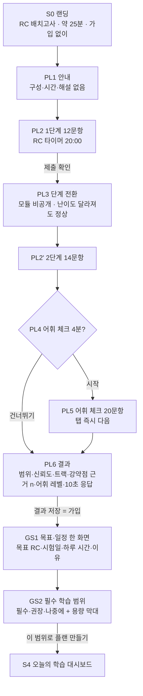
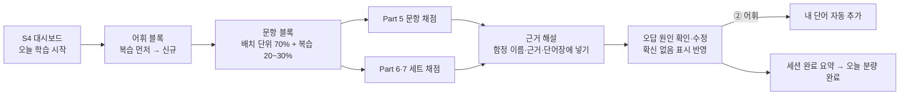

# PRD v1 — RC 구간 학습 웹 서비스 MVP 정의

- 작성: Product Planner / 보고 대상: Chief of Staff / 작성일: 2026-10-13 / 버전: **v1.0 (Phase 1 정의 기준 문서)** / 작업: S2-05
- 입력 (모두 `docs/` 아래): `decisions/2026-10-13-phase-1-start.md`, `decisions/2026-10-13-sprint-1-goal.md`, `specs/vision.md`(W1~W3), `roadmap.md`(F1~F10, RICE, Q1~Q9), `specs/placement-and-vocab.md` v0.2(F1·F2 확장·F11, Q-P1~P8), `design/core-flow.md`(R1~R4), `design/placement-vocab-flow.md`(R5~R9), `architecture.md`(D1~D10), `architecture-placement-vocab.md`(Q-D1~D10), `marketing/positioning.md`(M1~M7), `qa/content-standard.md`, `qa/review-batch1-p5p6.md`, `qa/review-batch1-p7.md`, `backlog.md`, `status.md`, `reports/sprint-1.md`
- **이 문서의 지위**: MVP의 범위·수용 기준·출시 조건에 대해서는 이 문서가 vision·roadmap·placement-and-vocab보다 우선한다. 세 문서는 근거 자료로 남긴다. 계산 규칙의 세부(우선순위 공식, 신뢰도 표, SRS 시간 계산 등)는 placement-and-vocab.md와 architecture 문서의 절을 그대로 참조하며, 이 문서는 그 절 번호를 적는다.
- `PLAN.md`는 여전히 읽지 못했다(toeic-rc-495 저장소 접근 권한 없음). 충돌이 있으면 PLAN.md가 우선하고, 접근 권한이 생기면 이 문서를 다시 맞춘다. → 열린 질문 U4

**표기**

| 표기 | 뜻 |
|---|---|
| **[기본값-결정]** | `decisions/2026-10-13-phase-1-start.md`에서 사용자가 따로 답하지 않아 CoS 추천안으로 진행하기로 한 항목. 사용자가 언제든 바꿀 수 있다 |
| **[PRD 확정]** | 이 문서에서 기획자가 팀 안 권장안을 확정한 항목. 근거 문서의 권장안을 따랐고, 바꾸려면 Product Planner·CoS 합의 |
| **[사용자 결정 대기]** | 15.1 목록. 확정·공개 전 사용자 승인 필요 |
| [가정] / [추정] / [사실] / [확인 필요] | 기존 문서와 같은 뜻. 숫자 기준값은 대부분 [가정]이며 S2 파일럿·베타 데이터로 보정한다 |

---

## 목차

1. [한 장 요약](#1-한-장-요약)
2. [문제](#2-문제)
3. [목표와 비목표](#3-목표와-비목표)
4. [페르소나와 세그먼트 우선순위](#4-페르소나와-세그먼트-우선순위)
5. [이길 지점 W1~W3](#5-이길-지점-w1w3)
6. [결정 현황 (기본값으로 정해진 것 포함)](#6-결정-현황)
7. [기능 목록 F1~F11](#7-기능-목록-f1f11)
8. [기능별 최종 수용 기준](#8-기능별-최종-수용-기준)
9. [디자이너 수정안 R1~R9 처리](#9-디자이너-수정안-r1r9-처리)
10. [Should-have와 제외 목록](#10-should-have와-제외-목록)
11. [핵심 사용자 흐름](#11-핵심-사용자-흐름)
12. [콘텐츠 요구량과 제작 상태](#12-콘텐츠-요구량과-제작-상태)
13. [성공 지표](#13-성공-지표)
14. [출시 단계와 클로즈드 베타 조건](#14-출시-단계와-클로즈드-베타-조건)
15. [리스크](#15-리스크)
16. [열린 질문 — (a) 사용자 결정 필요 / (b) 팀 내부 결정](#16-열린-질문)
17. [변경 기록과 다른 문서에 미치는 영향](#17-변경-기록과-다른-문서에-미치는-영향)

---

## 1. 한 장 요약

| 항목 | 내용 |
|---|---|
| 제품 | 토익 **RC 전용** 반응형 웹 학습 서비스 (LC·강의 없음) |
| 한 줄 정의 | **약 25분 배치고사로 RC 범위·약점·어휘 레벨을 재고, 목표 RC와 시험일에서 거꾸로 계산한 "꼭 해야 할 범위" 플랜을 하루 25분씩 따라가며, 검수된 문항의 근거 해설·오답 원인 복습·어휘 간격 복습으로 약점을 고치고, 범위와 근거가 있는 예측으로 진척을 확인한다.** |
| 대상 | 토익 RC 점수가 **자격 요건**인 사람: 공무원 7급·공기업 준비생(1순위), 승진 요건 직장인(2순위), 토익 받는 기업·졸업 인증(3순위) |
| MVP 트랙 | RC 300→400, 400→450 **[기본값-결정]**. 450→495는 Next (배치고사는 세 구간 모두 판정) |
| MVP 기능 | F1 배치고사 · F2 목표·필수 범위·마감형 플랜 · F3 분할 풀이 · F4 근거 해설 · F5 오답 원인 복습 · F6 모의고사 1회 · F7 설명 가능한 예측 · F8 실제 성적 입력 · F9 오류 신고 · F10 계정·단일 상품 결제 · F11 어휘 추천(**축소판** [기본값-결정]) |
| 기술 | Next.js + Supabase (+ Vercel, 토스페이먼츠) **[기본값-결정]**. 구현 착수 전 저장소 접근 필요 |
| 콘텐츠 | MVP 총 RC 문항 약 **880** + 어휘 체크 40 + 어휘 카드 1,000. 현재 **78문항 완료(교차 검수 통과, 원어민 검수 전)**, 배치고사 A폼 54문항과 어휘 카드 380개 **제작 중** |
| 출시 | S6~S7 무료 클로즈드 베타 100명 → 빠르면 S8 이후(2027년 1월 중순 이후) 유료 출시. 가격·환불은 초안만 유지, 확정·공개는 사용자 승인과 법률 검토 후 **[기본값-결정]** |
| 가장 큰 차단 요인 | ① 원어민 검수자 미확보(문항 공개 전 필수) ② 저장소 접근 권한 ③ 법률 검토 미착수(베타 전 개인정보 고지 필요) |

---

## 2. 문제

| # | 문제 | 근거 |
|---|---|---|
| P-1 | **RC가 발목을 잡는데 상품은 총점 단위다.** 한국 평균 RC 303 vs LC 375(약 70점 차이), 그러나 경쟁사 상품은 모두 700/800/900 총점 패키지·기간권 | [사실] vision W1, personas.md S1, competitors.md |
| P-2 | **마감이 있는 학습자에게 기간권이 맞지 않는다.** "60일/100일 패키지를 잘못 골라 시험 후에도 출석" 불만, 하루 2시간 이하 학습자 다수 | [사실] competitor-complaints 유형 3 |
| P-3 | **"풀고 채점하고 끝"이라 같은 실수를 반복한다.** 문항 오류·반복 출제 불만(산타), 해설 동선이 웹·교재 코드로 흩어짐(해커스), Part 6·7 근거 위치 없음 | [사실] complaints 유형 4·5, [일화] personas 페인포인트 4 |
| P-4 | **예측 점수를 믿을 수 없다.** "예상 점수가 후하다", "다 맞혀도 떨어진다", 빨리 풀면 미반영 — 왜 그 점수인지 설명이 없다 | [사실] complaints 유형 6 |
| P-5 | **무엇을 공부하지 않아도 되는지 아무도 말해 주지 않는다.** 범위 전체를 강의로 주거나, 대량 문항을 추천할 뿐 목표 점수에 맞춘 범위 자르기가 없다. 어휘는 별도 단어장으로 따로 논다 | [추정] placement-and-vocab 0장, 사용자 요청(2026-10-13) |
| P-6 | **시장 축소 압력.** 2026년 자소서 어학 성적에서 스피킹(52.1%)이 토익(47.9%)을 처음 앞섬 → "대기업 공채용 토익"은 줄고, **자격 요건형 수요**만 남는다 | [사실] personas.md S8 |

---

## 3. 목표와 비목표

### 3.1 목표 (MVP 클로즈드 베타 기준)

| # | 목표 | 측정 (13장) |
|---|---|---|
| G1 | 배치고사 → 목표 → 범위 → 플랜까지 **한 번에 이어지는** 첫 경험 | 배치고사 완료율 80%, 완료 → 트랙 시작 60% |
| G2 | 하루 25분 플랜을 **4주 동안 지키게** 한다 | 4주 차 주 3세션 이상 유지 40% |
| G3 | 오답을 **원인별로** 다시 풀어 같은 실수를 줄인다 | 같은 오답 태그 재정답률 +15%p, 해설 "도움" 80% |
| G4 | 예측을 **범위와 근거**로 보여 주고 실제 성적과 비교할 데이터를 모은다 | 실제 성적 입력률 30% |
| G5 | 공개 문항 품질을 **수치로 지킨다** | 치명 결함 0.5% 미만, 신고 분류 2영업일 안 90% |
| G6 | 유료 출시 판단에 필요한 **가격·세그먼트 근거**를 확보한다 | 세그먼트 1·2 비중 50% 이상, S2 설문 결과 |

### 3.2 비목표 (MVP와 Next에서 하지 않는다)

| # | 하지 않는 것 | 이유 |
|---|---|---|
| N1 | LC 학습 | RC 집중이 포지션 (Later 재검토) |
| N2 | 강의 영상·인강 플레이어 | 해설은 텍스트·하이라이트로 준다 |
| N3 | 문항 수 경쟁("1만 문항") | 검수 통과 문항만 공개 |
| N4 | ETS 기출·경쟁사 문항·시판 단어장 목록의 복제나 변형 | content-standard 8장, placement-and-vocab 3.1 |
| N5 | 출석·서류·성적 증빙 조건의 환급(리워드)형 상품 | 소비자 피해 유형 상위. 보장이 필요하면 조건 한 줄짜리만 (U2) |
| N6 | 점수 보장, "+N점" 약속, 근거 없는 최상급 광고, 조작·위장 후기 | positioning 8장, placement-and-vocab 2.3-4 |
| N7 | 네이티브 앱 | 반응형 웹. 모바일은 Part 5·복습·대시보드·어휘가 쓸 만하면 충분 |
| N8 | AI 튜터 채팅·자유 질문 | 응답 품질 보장 불가 |
| N9 | 커뮤니티·랭킹·B2B 관리자·다국어 UI | 핵심 루프와 무관 |
| N10 | 성적표 이미지 업로드 | 개인정보 최소 수집. 자기 보고 값만 |
| N11 | 사용자 화면에 "시험에 N% 나와요" 같은 출제 빈도 수치 표시 | 공식 통계 없음 (placement-and-vocab 가정 5) |

---

## 4. 페르소나와 세그먼트 우선순위

근거: vision.md 7장, positioning.md 0장·4장. 온보딩 "점수가 필요한 이유" 응답으로 세그먼트별 전환율을 잰다.

| 우선 | 세그먼트 | 대표 페르소나 | 주 트랙 | MVP에서 하는 일 | 메시지 방향 |
|---|---|---|---|---|---|
| **1** | 공무원 7급·공기업 준비생 | P1 김민지 (RC 300→400, 4~8주 단기, 주력 과목 병행) | 300→400 | 베타 우선 모집, 응시료 지원 안내(S2) | "커트라인, 시험일까지 짧게 끝내기" |
| **2** | 승진·사내 공모 요건 직장인 | P3 박성훈 (출퇴근 30분, 예측 불신) | 300→400, 400→450 | 베타 우선 모집, 모바일 Part 5·복습 | "출퇴근 25분, 승진 요건 RC만" |
| **3** | 토익 받는 기업·금융권 지원자, 졸업 인증 | P2 이준호 (RC 400→450, 오답 분석 정체, Part 7 시간 부족) | 400→450 | 베타 일반 모집 | "공채 마감까지 RC 목표 +50" ("목표" 표기 필수, M2) |
| **4** | 고득점 가점 필요 | P4 (함정·해설 깊이) | 450→495 (Next) | 배치고사만 + 대기 등록 | Next에서 확장 |
| 낮춤 | 스피킹으로 대체 가능한 대기업 공채 일반 | – | – | 광고비 쓰지 않음 | – |

- 베타 등록자 중 세그먼트 1·2 비중이 50% 미만이면 포지셔닝을 다시 본다(13장 지표 M-3).

---

## 5. 이길 지점 W1~W3

| # | 이길 지점 | 한 줄 주장 | 핵심 기능 | 경쟁사가 못·안 하는 이유 |
|---|---|---|---|---|
| **W1** | RC 구간 트랙 + 마감형 플랜 + **목표별 필수 범위** | "총점 말고 RC만. 시험일과 목표 RC에서 거꾸로 계산해, 꼭 할 것과 안 해도 되는 것을 이유와 함께 정해 준다." | F1, F2, F11 | 총점·기간권 상품 구조, RC만 팔면 LC 매출 잠식 [추정] |
| **W2** | 틀린 이유까지 가르치는 검수된 문항 | "문항 수가 아니라 정답 근거·오답 함정·내 실수 원인을 한 화면에서 보여 주고, 같은 이유로 틀릴 문제를 다시 준다." | F3, F4, F5, F9, F11 | 수천 문항에 함정 이름·근거 위치를 다는 비용, 해설을 강의 매출과 묶은 구조 [추정] |
| **W3** | 설명 가능한 RC 예측 | "예측을 범위·근거·신뢰도로 보여 주고, 근거가 적으면 넓게 말하며, 실제 점수와 비교한다." | F1 결과, F6, F7, F8 | 예측 점수가 마케팅·환급 조건과 묶여 있음 [추정] |

- 정직한 요금제·환불은 차별점이 아니라 **모든 기능의 바닥 원칙**이다(N5).
- 각 기능의 "경쟁사보다 나은 점" 한 줄은 7장 표에 있다.

---

## 6. 결정 현황

### 6.1 Phase 1 진입 결정에서 기본값으로 정해진 것 [기본값-결정]

출처: `decisions/2026-10-13-phase-1-start.md` (결정자: Vendetta@etri "다음 단계로 넘어가자", 세부 기본값은 Chief of Staff). **사용자가 언제든 바꿀 수 있다.**

| # | 항목 | 기본값 | 이 PRD에서의 반영 | 바꾸면 영향 |
|---|---|---|---|---|
| DF-1 | MVP 트랙 | **300→400, 400→450** (450→495는 Next) | 7장 범위, 12장 콘텐츠 | 450→495 추가 시 난이도 4~5 문항 대량 제작, 일정 1~2스프린트 지연 |
| DF-2 | 어휘 기능 범위 | **축소판(퀴즈 2종)으로 베타 일정 유지** | F11 수용 기준(8.11), 10장 Next 목록 | 전체판이면 개발 +약 0.7 인-스프린트, 베타 1스프린트 지연 위험 |
| DF-3 | 기술 스택 | **Next.js + Supabase** (구현 착수 전 저장소 접근 필요) | 14장 S3 착수 조건 | 다른 스택이면 architecture 문서 재작성 |
| DF-4 | 가격·환불 | **초안으로만 유지.** 6주 트랙권 ₩59,000 이하(S2 설문으로 결정), 7일 환불 + 일할 + 졸업 조건 미달 시 6주 무료 연장. **확정·공개는 사용자 승인과 법률 검토 후** | F10은 바닥 기준만, 베타는 무료 | – (U1·U2에서 결정) |

### 6.2 이 PRD에서 확정한 것 [PRD 확정]

근거 문서의 권장안을 그대로 택했다. 사용자가 다르게 원하면 바꾼다.

| # | 항목 | 확정안 | 근거 |
|---|---|---|---|
| PD-1 | 배치고사 방식 (Q-P1) | 2단계 고정형(MST): 공통 12 → 모듈 14 + 어휘 체크 20 | 실측 난이도 없는 지금 적응형 이점 없음 |
| PD-2 | 배치고사 길이 (Q-P2) | 약 24분 (RC 20분 + 어휘 4분) | 대분류마다 근거 2문항 이상 확보 |
| PD-3 | 목표 입력 (Q-P3) | 목표 RC 직접 입력 + 총점·LC 계산기 보조 | LC 추정치를 RC 목표에 섞지 않음 |
| PD-4 | 어휘 규모 (Q-P4) | MVP 목표 1,000장, 1차 380장 | 400→450 트랙도 MVP |
| PD-5 | 공개 어휘 목록 (Q-P5) | 대조·누락 점검만, 목록 가져오기 금지 (법률 검토 후 재검토) | ShareAlike 전파 여부 미확인 |
| PD-6 | 어휘 시간 위치 (Q-P6) | 하루 학습 시간 **안에** 포함 (15/25/40분 → 3/5/7분) | "하루 25분" 약속 유지 |
| PD-7 | "나중에" 범위 노출 (Q-P8) | 보여 주되 기본 접힘 (S2 인터뷰로 불안 여부 확인) | "안 해도 되는 것"이 차별점 |
| PD-8 | 1단계 중 시간 초과 (Q-D1) | 판정 안 함 + B폼 재응시 또는 트랙 직접 선택 | spec v0.2 반영 완료 |
| PD-9 | 로그인 수단 (D3) | 이메일 매직링크 + 카카오 | F10 "소셜 1종" |
| PD-10 | F9 자동 중단 기준 (D6) | 같은 문항에 **서로 다른 사용자 3명**의 "정답 이상" 신고 | 한 사람의 반복 신고로 중단되는 남용 방지 |
| PD-11 | 모의고사 이탈 처리 (core-flow S9) | **1회 일시정지 허용**, 결과·예측 근거에 "일시정지 1회" 표시 | 직장인 중단 상황 현실 반영, 투명성 유지 |
| PD-12 | 총점 환산 표기 | 사용자가 LC 점수를 넣었을 때만 "총점 참고" 표시. 평균 LC로 대신 계산하지 않음 | PD-3과 같은 원칙 |
| PD-13 | 함정 코드 `STATED_IN_PASSAGE` (P7 검수 요청) | **함정 코드 목록에 등록**한다. NOT 문항 오답(지문에 언급된 사실) 전용 | 기존 코드로는 약점 리포트가 잘못 집계됨 |
| PD-14 | Part 6·7 지문 전체 번역 (P5·P6 검수 지적) | 세트 단위 필드 `passage_translation_ko` 추가, **공개 전 필수**. 해설 화면 "지문 번역 보기"(접힘)로 노출 | content-standard 6.3 요구, SCHEMA에 필드 없음 |
| PD-15 | 가상 URL 형식 (P7 검수 지적) | 모든 지문의 URL을 `*.example.com` 하위 도메인으로 통일 | 실제 등록 가능한 도메인 노출 위험 0 |
| PD-16 | 마케팅 숫자 표기 (M2) | 헤드라인 기본은 숫자 없는 안. 숫자를 쓰면 반드시 "목표" 표기("RC 50점, 목표로 잡고 6주 플랜") | 점수 약속 금지 (N6) |
| PD-17 | 모바일 지원 수준 (Q9) | Part 5 풀이·오답 복습·대시보드·어휘 블록은 모바일 완결, Part 6·7은 전환형 화면(F3-2)으로 가능하되 PC 권장 안내 | 웹 우선, 장문은 PC 강점 |

---

## 7. 기능 목록 F1~F11

| ID | 기능 | MVP 범위 | 이길 지점 | 경쟁사보다 나은 점 (한 줄) | RICE 순위·비고 |
|---|---|---|---|---|---|
| **F1** | RC 배치고사 | 2단계 26문항(RC 20분) + 어휘 체크 20문항(4분, 건너뛰기 가능), A·B 두 폼 | W1, W3 | 한 숫자 대신 RC 범위·신뢰도·유형별 강약점(근거 수 포함)·"판단 보류"·어휘 레벨까지 공개 | 640 · 가입 없이 시작 |
| **F2** | 목표·필수 범위·마감형 플랜 | 목표 RC + 시험일 + 하루 시간 + 이유 → 필수/권장/나중에 범위 → 주차별 플랜·졸업 조건·재배분 | W1 | 기간권이 아니라 시험일·목표에서 거꾸로 계산하고, **안 해도 되는 범위**까지 이유와 함께 알려 준다 | 840 |
| **F3** | 웹 분할 풀이 화면 | Part 5 단일, Part 6·7 지문·문항 분할, 세트 채점 기본(R1) | W2 | 이중·삼중 지문을 한 화면에 펼치고 글자 크기·이동을 자유롭게 | 720 |
| **F4** | 근거 해설 | 같은 화면 해설, 근거 문장 하이라이트, 고른 오답의 함정 이름, 지문 번역, 단어장에 넣기 | W2 | 페이지 이동·코드 입력 없이 근거 위치와 오답별 함정 이름까지 | **1,440 (1위)** |
| **F5** | 오답 원인 태깅 + 원인별 복습 | 원인 5종, 채점 전 "확신 없음"(R2), 원인 묶음 복습, 간격 복습 | W2 | "틀린 문제 다시"가 아니라 "같은 이유로 틀릴 **다른** 문제"를 준다 | 420 · W2 핵심이라 MVP |
| **F6** | RC 모의고사 1회 | 100문항·75분, 문항 목록 이동, 일시정지 1회(PD-11) | W3 | 예측의 기준점이 되는 실전 형식 측정 | 840 |
| **F7** | 설명 가능한 RC 예측 | 범위 + 중앙값 + 근거 + 변동 이유, "베타" 라벨, 신뢰도 | W3 | 한 숫자가 아니라 범위·근거·데이터 양, 변동 이유 공개 | 400 · W3 핵심이라 MVP |
| **F8** | 실제 성적 입력 | 시험 후 자기 보고 RC 점수 → 예측 범위와 비교 | W3 | 예측 정확도를 검증·공개할 데이터를 모은다 | 360 |
| **F9** | 문항 오류 신고 | 모든 문항·해설·어휘 카드, 자동 중단, 재채점 | W2 | 신고 → 처리 결과 회신까지 정해진 시간 안에 | 540 |
| **F10** | 계정·결제 (단일 상품) | 이메일 + 카카오 로그인, 기기 제한 없음, 상품 1개, 2클릭 해지·환불. **베타는 결제 비활성** | 기반 | 요금제 하나, 해지·환불 동선을 숨기지 않는다 | RICE 제외(사업 필수) |
| **F11** | 어휘 추천 (**축소판**) | 카드(기초·400·450), 첫 노출 거르기, 1·3·7·14일 복습, 퀴즈 2종(문맥 뜻·파생어 빈칸), 오답 단어 자동 추가, 기본 어휘 현황 | W1, W2 | 따로 노는 단어장이 아니라 내 목표 레벨과 내 오답에서 만든 단어장을 Part 5 품사·어휘 문항과 연결 | 400 · 사용자 요청 |

**개발 순서 [제안, architecture 11장 + placement-vocab 6장 정합]**: S3 = F1(배치·분기·결과) + F3 + F4 + 범위 엔진 / S4 = F2 플랜·재배분 + F5 + F9 + F11 어휘 엔진 / S5 = F6 + F7 + F8 + F10(테스트 키). 개발 용량 정합은 15장 R-3, 16장 I-14.

---

## 8. 기능별 최종 수용 기준

> 형식: **Given** 조건 / **When** 행동 / **Then** 결과. 각 항목 번호(예: F1-3)는 qa 테스트 케이스 ID로 그대로 쓴다. 괄호 안은 출처 또는 반영한 수정안이다. 숫자 기준값은 [가정]이며 설정값으로 구현한다(architecture 7장 원칙).

### 8.1 F1 RC 배치고사

구성: 1단계 공통 12문항(Part 5 8 + Part 6 1세트) → 2단계 모듈 14문항(기초/중간/상위 중 1개) → 어휘 체크 20문항(레벨 4개 × 5단어). 분기·구성·신뢰도 규칙은 placement-and-vocab 1.3~1.6.

| ID | Given | When | Then |
|---|---|---|---|
| F1-1 | 비회원이 랜딩에서 "RC 배치고사 시작"을 누름 | 시작 | 가입 없이 1단계 1번 문항이 뜨고 남은 시간(20:00), 진행률(n/26), "1단계 n/12"가 보인다 |
| F1-2 | 1단계 12문항을 풂 | "1단계 제출" | "제출하면 1단계로 돌아갈 수 없어요" 확인(안 푼 문항 번호 바로가기 포함)을 거쳐 기초/중간/상위 모듈 중 하나가 열린다. 모듈 이름은 응시 중에는 보이지 않고 결과 화면에서만 보인다 |
| F1-3 | 2단계로 넘어가는 전환 화면 | 표시 | 모든 응시자에게 같은 문구 "1단계 결과에 맞춰 문제를 골랐어요. 난이도가 달라져도 정상이에요."가 보인다 **(R9, 문구 수정 채택)** |
| F1-4 | RC 20분이 지남 | 시간 종료 | 자동 제출되고 어휘 체크 안내로 넘어간다. 응답이 13문항 미만이면 판정하지 않고 결과 화면에 "B폼으로 다시 보기"와 "트랙 직접 골라 플랜 만들기"(첫 예측은 세션 30문항 뒤)를 준다 (PD-8) |
| F1-5 | 어휘 체크 안내 화면 | "건너뛰기" | 결과 화면이 열리고, 어휘 레벨은 트랙 기본 레벨(300→400 = 400, 400→450 이상 = 450)에서 RC 어휘 문항 3개 중 0~1개 정답이면 한 레벨 낮춘 값으로 "간이 추정" 표시된다. "건너뛰기"는 주 버튼과 같은 크기다 |
| F1-6 | 어휘 체크 풀이 | 보기를 누름 | 채점 버튼 없이 바로 다음 문항으로 넘어가고, "← 이전"으로 돌아가 답을 바꿀 수 있다. 보기는 4개 + "모르겠어요"(오답 처리) **(R7 채택)** |
| F1-7 | 어휘 체크 20문항 또는 4분 종료 | 결과 | 레벨별 통과 여부(5개 중 4개 이상)와 "OOO 레벨부터 시작"이 보이고 퍼센트는 보이지 않는다. 안 푼 문항은 "모르겠어요"로 처리하고 개수를 표시한다 |
| F1-8 | 배치고사 완료 | 결과 화면 | RC 범위(하한~상한, 중앙값, 반폭 ≥ 50), "베타" 라벨, 근거 문항 수, 신뢰도(낮음/보통 + 이유 한 줄, "높음"은 잠금 + "모의고사 후 열려요"), 배정 트랙, 대분류 강약점 맵, 어휘 레벨, **10초 안에 답한 문항 수**와 시간 안에 못 푼 문항 수가 보인다 **(R4 채택)** |
| F1-9 | 강약점 맵 | 그리기 | 대분류마다 상태(▼ 약점 / ● 보통 / ▲ 강점 / ? 판단 보류)와 **"근거 n문항"**이 같이 보이고, 색만이 아니라 모양·라벨로 구분된다. 근거 2문항 미만 대분류는 "판단 보류"로만 표시된다 **(R5 채택)** |
| F1-10 | 신뢰도 "낮음" 조건(응답 13~19, 10초 안 응답 5개 이상, 2단계 정답률 30% 미만·90% 초과) | 결과 | 반폭이 ±60으로 넓어지고 이유 문구가 보인다. 배치고사에서 "높음"은 절대 표시되지 않는다 |
| F1-11 | 추정 하한이 450 이상 | 결과 | "450→495 트랙은 준비 중" + 대기 등록 버튼, 400→450 트랙 고난도 세션을 대안으로 제안한다 |
| F1-12 | 경계 구간(390~405) | 결과 | "두 트랙 경계예요" + 두 트랙 중 선택권을 준다 (architecture 7.1) |
| F1-13 | 배치고사 도중 브라우저를 닫음 | 24시간 안에 다시 엶 | 마지막 응답 다음부터 이어 풀고, 이미 분기된 모듈은 바뀌지 않는다 |
| F1-14 | 비회원이 결과를 봄 | "결과 저장하고 목표 정하기" | 가입 후 결과가 계정에 그대로 연결되고 다시 풀지 않는다 |
| F1-15 | A폼을 푼 회원 | 재배치 요청 | B폼(1단계·모듈·어휘 체크 모두 다른 문항)이 나오고 A폼은 다시 풀 수 없다. 재배치는 3주 차 이후 권장 안내 |
| F1-16 | 어휘 체크 응답 | RC 예측(F7) 계산 | 근거에 들어가지 않는다 |
| F1-17 | 배치고사 중 | 문항 풀이 | 해설은 보이지 않는다. 결과 화면에서 대분류 칸을 누르면 푼 문항의 정오와 해설을 볼 수 있다 |

### 8.2 F2 목표·필수 범위·마감형 플랜

계산 규칙: 우선순위 P = F(빈도) × C(목표 구간 기여도) × W(내 약점), 각 1~3, 필수 ≥ 12 / 권장 6~9 / 나중에 ≤ 4, 용량 규칙·재계산·주차 배치는 placement-and-vocab 2.2~2.6, architecture-placement-vocab 3.5.

| ID | Given | When | Then |
|---|---|---|---|
| F2-1 | 배치고사를 마친 회원 | 목표·일정 화면(플랜 설정 폼 하나) | **목표 RC(첫 칸, 트랙 상단 값 미리 채움)**, 시험 예정일, 평일 하루 시간(15/25/40분), 필요 이유를 **한 화면**에서 받는다. "총점 + LC로 계산" 보조 입력을 열 수 있다. 결과 화면 → 범위 화면까지 클릭 2회 이내 **(R6 채택)** |
| F2-2 | (목표 − 현재 중앙값) ÷ 남은 주 > 15점 | 저장 | "도전적인 목표예요 · 참고 기준" 안내와 다음 시험일 선택지가 보이고 저장은 막지 않는다 |
| F2-3 | 남은 기간 < 트랙 권장 6주 | 플랜 생성 | "기간이 짧아 하루 N분이 필요해요" 경고와 압축 플랜 / 다음 시험일 선택지를 보여 준다 |
| F2-4 | 시험일 "아직 안 정했어요" | 플랜 생성 | 기본 6주 플랜이 만들어지고 대시보드에 "시험일을 정하면 플랜이 맞춰져요"가 보인다 |
| F2-5 | 목표·시험일·하루 시간이 정해짐 | 범위 화면 | 학습 단위가 필수 → 권장 → 나중에(기본 접힘) 순으로 보이고, 단위마다 이유 한 줄, **말로 된 근거 칩 3개**(빈도/목표 기여/내 상태), 분량, 배치 주차가 보인다. **P 숫자와 F·C·W 값은 "왜 이 순서인가요?" 펼침에서만** 보인다. 단위별 "+N점" 표시는 없다 **(R8 채택)** |
| F2-6 | 범위 화면 상단 | 표시 | 용량 막대(신규 학습 용량 중 필수·권장 분량)가 보이고, 어휘는 "매일 N분 · 별도"로 막대 밖에 표시된다 |
| F2-7 | 필수 분량 합 > 신규 학습 용량 | 범위 계산 | P가 낮은 필수부터 권장으로 옮겨지고 "기간이 짧아 필수 범위 중 N개를 권장으로 옮겼어요"와 옮긴 단위 라벨이 보인다 |
| F2-8 | 사용자가 "나중에" 단위 | "플랜에 넣기" | 용량 안이면 권장 끝에 들어가고, 넘으면 어떤 권장 단위가 밀리는지 미리 보여 준 뒤 확인을 받는다 |
| F2-9 | 플랜 생성 | 주차별 보기 | 필수 단위가 기초·확장 단계 주차에 P 순으로 배치되고, 모의고사가 실전 단계 첫 주에 놓인다. 대시보드에 "필수 범위 진척 n / N 완료"가 보인다 |
| F2-10 | 졸업 조건이 정의된 트랙 [가정: 300→400 = Part 5 85%, Part 7 단일 70%, 예측 하한 400 이상 / 400→450 = Part 5 90%, Part 6 80%, Part 7 지문당 평균 시간 기준 이내, 예측 하한 450 이상] | 대시보드 | 각 조건의 현재 값 / 목표 값이 숫자로 보인다. 조건은 "목표"로 표기하고 약속으로 쓰지 않는다 |
| F2-11 | 세션 응답 30문항마다, 모의고사 후, 목표·시험일 변경 시 | 범위 재계산으로 분류가 바뀜 | 바뀐 단위와 이유가 한 줄로 기록·표시된다. 이미 지난 주차의 배치는 바꾸지 않는다 (Q-D10) |
| F2-12 | 단위 최근 10문항 첫 시도 정답률 ≥ 80%(Part 7은 70%) | 다음 재계산 | 그 단위는 "완료 · 복습만"으로 표시되고 신규 배치에서 빠진다 |
| F2-13 | 사용자가 이틀 이상 세션을 건너뜀 | 대시보드 | 남은 기간에 맞춰 플랜이 재배분되고 무엇이 바뀌었는지 한 줄 + **"되돌리기"**가 보인다. 재배분으로 하루 시간이 **10분 이상 늘어나면 자동 적용하지 않고 사용자 확인**을 받는다(대안: 다음 시험일, 권장 단위 빼기) **(R3 채택)** |
| F2-14 | 하루 세션을 엶 | 구성 보기 | 어휘 블록(N분)과 문항 블록이 나뉘어 보이고 합이 설정 시간과 같다. 문항 블록은 "이번 주 배치 단위 약 70% + 복습 20~30%" |
| F2-15 | 설정한 시간 분량을 마침 | 세션 종료 | "오늘 분량 완료"가 보이고 추가 학습은 선택으로만 제안된다 |

### 8.3 F3 웹 분할 풀이 화면

| ID | Given | When | Then |
|---|---|---|---|
| F3-1 | 화면 너비 1024px 이상, Part 6·7 세트 | 열기 | 왼쪽 지문(이중·삼중 지문은 탭 또는 세로 스크롤로 모두), 오른쪽 문항이 동시에 보이고 따로 스크롤된다 |
| F3-2 | 1024px 미만 | Part 6·7 세트 열기 | 지문/문항 전환 버튼이 고정 위치에 있고 전환해도 스크롤 위치가 유지된다. 첫 진입 시 "긴 지문은 PC가 편해요" 안내 1회 (PD-17) |
| F3-3 | 모든 문항 화면 | 글자 크기 조절(4단계) | 지문·문항·해설 크기가 바뀌고 다음 접속에도 유지된다. 브라우저 200% 확대에서 리플로우된다 |
| F3-4 | **Part 5** | 답 선택 | **문항마다 채점**한다 **(R1)** |
| F3-5 | **Part 6·7 세트** | 문항 이동 | 세트 안에서 이전·다음으로 자유롭게 오가며 답을 바꿀 수 있고, **"세트 채점하기" 한 번으로 세트 전체를 채점**한다. 채점 버튼과 다음 버튼은 다른 위치·라벨이다. 세트 채점 전에는 어떤 문항의 해설·근거 하이라이트도 열리지 않는다 **(R1 채택, "Part 7도 문항마다" 설정은 Next)** |
| F3-6 | 문항 풀이 | 완료 | 문항별 풀이 시간을 기록하고 Part 6·7은 세트 시간도 기록한다 |
| F3-7 | 문항 화면 | 채점 전 | **"확신 없음" 토글**이 보이고 한 번에 켜고 끌 수 있다 (F5-2와 연결) **(R2)** |
| F3-8 | 일반 세션 중 탭 이탈 | 복귀 | 일반 세션은 시간 기록이 멈췄다가 이어진다. 배치고사·모의고사는 시간이 계속 흐르고 복귀 시 안내한다 |
| F3-9 | 키보드만 사용 | 풀이 → 채점 → 해설 → 근거 → 신고 | 전 과정이 가능하다(1~4/A~D, ←/→, Esc). 입력 칸 포커스 중에는 단축키가 꺼진다. WCAG 2.1 AA (core-flow 6.5) |
| F3-10 | 표준 PC 브라우저(Chrome·Edge·Safari 최신 2개 버전) | 문항 화면 열기 | 3초 안에 상호작용 가능 [가정, qa가 측정 기준 확정] |

### 8.4 F4 근거 해설

| ID | Given | When | Then |
|---|---|---|---|
| F4-1 | 문항(Part 5) 또는 세트(Part 6·7) 채점 | 결과 | 같은 화면에서 해설이 열린다. 페이지 이동·코드 입력·재로그인이 없다 |
| F4-2 | Part 6·7 해설 | "근거 보기" | 지문의 근거 문장(문장 ID 기준)이 하이라이트되고 그 위치로 스크롤·포커스가 이동한다. 연계 문항은 여러 지문의 근거가 모두 표시된다 |
| F4-3 | 사용자가 오답 보기를 골랐음 | 해설 열림 | 그 보기의 함정 이름(예: "지문 단어 반복 함정")과 틀린 이유가 맨 위, 나머지 보기 이유는 펼쳐 볼 수 있다 |
| F4-4 | Part 6·7 해설 | "지문 번역 보기" | 세트 전체 번역이 접힘 영역으로 열린다 (PD-14) |
| F4-5 | 해설의 어휘 목록 | "단어장에 넣기" | 그 단어가 F11 "내 단어"에 들어가고 다음 날 신규 카드 맨 앞에 배치된다 (F11-5) |
| F4-6 | 해설 하단 | "도움이 됐어요 / 아니에요" | 응답이 `item_id`·버전과 함께 저장된다 |
| F4-7 | `published`가 아닌 문항 | 어떤 학습 화면 | 노출되지 않는다. 파일럿 예외로 노출하는 문항은 "새 문항" 표시를 붙인다 (content-standard 9장) |

### 8.5 F5 오답 원인 태깅 + 원인별 복습

원인 5종: ① 문법 개념 ② 어휘 ③ 함정(고른 보기의 함정 코드) ④ 시간(파트 중앙값의 1.5배 초과) ⑤ 찍음(사용자 표시). 복습 주기 규칙은 architecture 7.4.

| ID | Given | When | Then |
|---|---|---|---|
| F5-1 | 문항을 틀림 | 해설 열림 | 시스템이 추정한 원인(①~④ 중 1~2개)이 보이고 한 번의 클릭으로 바꾸거나 "찍었어요"를 고를 수 있다 |
| F5-2 | 채점 전 "확신 없음"을 켬 | 채점 | 틀렸으면 원인 기본값에 ⑤가 함께 붙고, **맞혔어도 "확신 없이 맞힌 문항"으로 복습 대기열에 들어간다**. 예측(F7) 계산에는 정오만 쓰고 이 표시는 쓰지 않는다 **(R2 채택)** |
| F5-3 | 오답이 쌓임 | 오답노트 | 원인별·유형 태그별로 묶여 보이고 묶음마다 틀린 횟수와 최근 정답률이 보인다 |
| F5-4 | 같은 원인 묶음 오답 ≥ 3 | 다음 세션 생성 | 같은 유형·함정 태그의 **다른** 문항이 세션 복습 몫(20~30%)으로 들어간다 |
| F5-5 | 이미 맞힌 문항 | 복습 세트 생성 | 7일 안에는 다시 나오지 않는다 |
| F5-6 | 오답노트에서 "이해함" | 표시 | 그 문항은 다음 복습 주기(3일·7일)에 한 번 더 나온다 |
| F5-7 | 원인이 ② 어휘 | 해설 닫힘 | F11-4 규칙으로 단어가 자동 추가된다 |
| F5-8 | 오답 원인 데이터 | 범위 재계산 | 원인 ①·② 묶음이 해당 학습 단위의 W(약점) 값에 반영된다 (placement-and-vocab 2.3) |

### 8.6 F6 RC 모의고사 1회

| ID | Given | When | Then |
|---|---|---|---|
| F6-1 | 트랙 실전 단계(3주 차 이후) 또는 사용자가 원함 | 시작 | 시작 전 시간 고지 후 실제 형식(Part 5 30 · Part 6 16 · Part 7 54, 75분)으로 진행되고 남은 시간이 보인다. 3주 차 전에는 "3주 차부터 권장 · 지금 풀어 보기" |
| F6-2 | 모의고사 중 | 문항 목록 | 푼·안 푼·표시한 문항이 구분되고 어느 문항으로든 이동할 수 있다 |
| F6-3 | 모의고사 중 | "일시정지" | **1회만** 허용되고, 결과·예측 근거에 "일시정지 1회(n분)"가 기록된다 (PD-11) |
| F6-4 | 75분 경과 | 종료 | 자동 제출되고 파트별 정답률·소요 시간·미응답 수가 나온다 |
| F6-5 | 모의고사 완료 | 결과 | F7 예측이 갱신되고(신뢰도 "높음" 조건 판단), 오답은 F5로, F2 범위가 재계산된다 |

### 8.7 F7 설명 가능한 RC 예측

모델: architecture 7.5 (난이도 기반 로지스틱 + 데이터 양에 따른 최소 반폭). 실제 성적 데이터가 0건인 동안 예측은 가설이다.

| ID | Given | When | Then |
|---|---|---|---|
| F7-1 | 배치고사 완료 | 대시보드 | 배치 결과가 첫 예측으로 "RC 하한~상한 · 중앙값 · 베타"로 표시된다 |
| F7-2 | 예측 카드 | "근거 보기" | 근거 문항 수, 파트별 정답률, 예측을 가장 끌어내리는 요인 상위 2개, 범위를 좁히는 데 필요한 추가 문항 수가 보인다 |
| F7-3 | 근거 문항 수가 적음 | 계산 | 범위가 넓어진다(60문항 미만 ±50, 모의고사 포함 150문항 이상 ±25 [가정]). 범위를 일부러 좁게 표시하지 않는다. 신뢰도 "높음"은 모의고사 포함 150문항 이상일 때만 |
| F7-4 | 중앙값이 직전보다 10점 이상 바뀜 | 대시보드 | 바뀐 이유가 한 줄로 보인다 |
| F7-5 | 예측의 "끌어내리는 요인"과 범위 화면의 약점 | 같이 볼 때 | 두 화면의 약점 유형이 서로 모순되지 않는다(같은 계산, 같은 시점 데이터) |
| F7-6 | 어떤 경우든 | 예측 표시 | 환급·보장 조건으로 쓰지 않고, 정확도 수치는 표본 100건 + 목표 달성 전에는 대외에 쓰지 않는다 |

### 8.8 F8 실제 성적 입력

| ID | Given | When | Then |
|---|---|---|---|
| F8-1 | 시험 예정일이 지난 사용자 | 성적 발표 예정일(시험일 + 약 10일 [확인 필요]) 이후 접속 | 실제 RC 점수 입력 요청이 한 번 뜬다(닫기 가능) |
| F8-2 | RC 점수(5~495, 5점 단위) 입력 | 저장 | 마지막 예측 범위와 비교("범위 안 / 위 / 아래")가 보이고 정확도 집계에 들어간다 |
| F8-3 | MVP | 성적 입력 | 성적표 이미지는 받지 않는다. 자기 보고 값만 |

### 8.9 F9 문항 오류 신고

| ID | Given | When | Then |
|---|---|---|---|
| F9-1 | 모든 문항·해설·**어휘 카드** 화면 | "오류 신고" | 유형(정답 이상 / 해설 이상 / 오탈자 / 기타) + 자유 입력이 뜨고 `item_id`(또는 `word_id`)·버전·고른 답·브라우저 정보가 자동 첨부된다. 풀이 흐름이 끊기지 않는다 |
| F9-2 | 신고 접수 | 1영업일 안 | 사용자에게 접수 알림이 간다 |
| F9-3 | 같은 문항에 **서로 다른 사용자 3명**의 "정답 이상" 신고 | 세 번째 신고 | 그 문항은 자동 `suspended`가 되어 새 세션에 나오지 않는다 (PD-10) |
| F9-4 | 정답이 바뀐 수정본 공개 | 반영 | 이미 푼 사용자의 채점·오답노트·예측·범위가 재계산되고 알림이 간다 (content-standard 11.3) |

### 8.10 F10 계정·결제 (단일 상품)

상품 구조·가격·환불 조건은 U1·U2 결정 후 채운다. 아래는 어떤 안이든 지킬 바닥 기준이다. **클로즈드 베타에서는 결제를 열지 않는다**(테스트 키로만 검증).

| ID | Given | When | Then |
|---|---|---|---|
| F10-1 | 이메일 매직링크 또는 카카오로 가입 | 다른 기기·브라우저에서 로그인 | 기기 등록·재인증 없이 기록이 이어진다 (PD-9) |
| F10-2 | 결제 화면 | 상품 보기 | 상품은 1개(최대 2개), 가격·기간·환불 조건이 3줄 안에 같은 화면에 보인다 |
| F10-3 | 결제한 사용자 | 해지·환불 원함 | 설정에서 2번 클릭 안에 해지·환불 요청에 도달한다. 해지 설문은 건너뛰기를 같은 크기로 둔다 |
| F10-4 | 결제 후 7일 안 | 환불 요청 | 실결제가 기준으로 처리된다 [초안, U2 결정 + 법률 검토 전에는 공개하지 않음] |
| F10-5 | 가입 | 동의 화면 | 서비스 알림 동의와 광고성 정보 수신 동의가 분리되고 광고성은 선택이다. 수집 항목·보유 기간이 고지된다 [법률 검토, U5] |

### 8.11 F11 어휘 추천 (축소판)

MVP 포함: 카드 열람, 첫 노출 거르기, 1·3·7·14일 간격 복습, 퀴즈 2종(① 문맥 뜻 고르기 ② 파생어 빈칸), 오답 자동 추가·간이 카드, 기본 어휘 현황. Next로: 퀴즈 3종(콜로케이션·패러프레이즈·혼동어), 어휘 대시보드 상세, 유형 카드 화면, 495 레벨. 규칙 세부는 placement-and-vocab 3.4~3.5.

| ID | Given | When | Then |
|---|---|---|---|
| F11-1 | 어휘 레벨 "400 레벨부터" | 첫 세션 | 어휘 블록에 400 레벨 신규 카드가 하루 시간에 맞는 개수(15/25/40분 → 상한 8/12/15개)로 나온다 |
| F11-2 | 새 카드 첫 노출 | "알아요" | 문맥 퀴즈 1개가 바로 나오고 맞히면 "아는 단어"로 14일 뒤 한 번만 다시 나온다. 틀리면 신규 학습으로 돌아간다 |
| F11-3 | 카드 학습 | 복습 일정 | 1·3·7·14일 간격으로 퀴즈가 나오고 틀리면 1일로 돌아간다. 14일 단계 통과 = "익힌 단어" |
| F11-4 | 오답 원인 ② 어휘 | 해설 닫힘 | 정답 단어와 고른 오답 보기 단어(문항 `vocab[].option`으로 연결, 카드가 없으면 간이 카드)가 "내 단어"에 추가되고 "단어 n개를 단어장에 넣었어요"가 보인다. 하루 자동 추가는 5개까지, 같은 단어가 다시 나오면 새 카드 없이 복습 단계를 1일로 되돌린다 |
| F11-5 | 신규 카드 순서 | 그날 어휘 블록 생성 | 수동 추가 → 오답 자동 추가 → 필수 단위 태그와 겹치는 단어 → 현재 레벨 나머지 순이다 |
| F11-6 | 카드 펼침 | 보기 | 표제어, 품사, 뜻, 토익 맥락 예문(번역 포함), 콜로케이션, 파생어(400 레벨 이상), 혼동어(있으면), 출제 유형 이름이 보이고 "이 단어가 나온 문제 보기"는 풀어 본 문항만 연결한다 |
| F11-7 | 그날 복습 예정 카드가 있음 | 어휘 블록 생성 | 복습을 먼저 넣고 남은 시간만큼 신규를 넣으며 예상 시간이 하루 배분(3/5/7분)을 넘지 않는다. 복습만으로 넘치면 신규 0개와 "오늘은 복습만 해요"가 보인다 |
| F11-8 | 퀴즈 오답 보기 생성 | 템플릿 | 정답 단어의 동의어·같은 어족 단어는 오답 보기에서 제외된다(정답 유일성) |
| F11-9 | `published`가 아닌 카드 | 어떤 화면 | 노출되지 않는다. 간이 카드는 "간이 카드" 표시를 붙인다 |
| F11-10 | 어휘 현황 | 보기 | 익힌 단어 수, 오늘 복습 수, 현재 레벨 진척(예: 400 레벨 132 / 450)이 보인다 |
| F11-11 | 어휘 퀴즈 응답 | 저장 | 문항 응답(`attempts`)과 분리 저장되어 RC 예측에 섞이지 않는다 |

---

## 9. 디자이너 수정안 R1~R9 처리

| # | 대상 | 수정안 요지 | 결정 | 한 줄 이유 | 반영 위치 |
|---|---|---|---|---|---|
| R1 | F3·F4 채점 단위 | Part 5 문항 채점, Part 6·7 세트 채점 기본 + "Part 7도 문항마다" 설정 | **채택 (설정 옵션은 Next)** | 세트 안 근거 하이라이트가 다른 문항 정답을 드러내므로 세트 채점이 맞고, 문항 채점 옵션은 같은 누출 문제를 다시 만들어 MVP에서 뺀다 | F3-4, F3-5, F4-1 |
| R2 | F5 '찍음' 원인 | 채점 전 "확신 없음" 토글 추가 | **채택** | 사후 편향 없이 "확신 없이 맞힌 문항"까지 복습 대상으로 잡아 W2를 강화하고 비용은 클릭 1회다 | F3-7, F5-2 |
| R3 | F2 자동 재배분 | "되돌리기" + 하루 10분 이상 늘면 사용자 확인 | **채택** | "하루 25분" 약속이 말없이 늘면 W1 신뢰가 깨진다 | F2-13 |
| R4 | F1 결과 | "10초 안에 답한 문항 n개" 표시 + 응답 부족 시 구간 대신 이어 풀기 | **채택 (기준 수치 조정)** | 빠른 응답을 공개하는 투명성은 W3에 맞고, 응답 부족 기준은 26문항 배치고사에 맞춰 15→**13문항**으로 바꾼다(spec 1.6) | F1-4, F1-8, F1-10 |
| R5 | F1 강약점 맵 | 대분류마다 "근거 n문항" 표시 | **채택** | 2~3문항으로 본 약점이라는 한계를 정직하게 보여 준다 | F1-9 |
| R6 | F2 목표 입력 | 목표 RC를 플랜 설정 폼 첫 칸으로 합침 | **채택** | 범위 계산에 시험일·하루 시간이 어차피 함께 필요하고 클릭 수가 줄어든다 | F2-1, 11장 흐름 |
| R7 | F11 어휘 체크 | 보기 누르면 바로 다음, "이전"으로 수정 | **채택** | 문항당 12초에서 확인 탭은 측정 노이즈다 | F1-6 |
| R8 | F2 범위 표시 | P 숫자 숨기고 말로 된 근거 칩, 숫자는 펼침에만 | **채택** | "P 27"이 점수 약속처럼 읽히는 위험을 막고 빈도 수치 비공개 원칙과 맞는다 | F2-5 |
| R9 | 배치고사 단계 전환 | 모듈 비공개 + "어렵게 느껴져도 정상이에요" 고정 문구 | **채택 (문구 수정)** | 기초 모듈 응시자는 쉬워지므로 "난이도가 달라져도 정상이에요"로 바꿔 모든 모듈에 맞게 하고, 최종 문구는 marketer가 다듬는다 | F1-3 |

- 거부한 수정안은 없다. 부분 수정 3건(R1 옵션 이연, R4 기준 수치, R9 문구)은 위 이유대로다.
- **디자인 문서 정합 요청**: placement-vocab-flow PL2 "1단계 중 20분 경과 → 1단계 응답으로 채점" 문구는 spec v0.2(판정 안 함)와 어긋난다 → F1-4 기준으로 고친다(I-20).

---

## 10. Should-have와 제외 목록

### 10.1 Should-have (MVP 여유가 있으면)

| ID | 기능 | 판단 |
|---|---|---|
| S1 | 학습 리마인더(이메일 → 이후 카카오 알림) | 여유 있으면 베타에 이메일만 |
| S2 | 지자체 응시료 지원 안내 카드 | **포함 권장** (개발 비용 거의 0, P1 신뢰). 지역 정보는 출처·기준일 표기 |
| S3 | 주간 리포트(원인 상위 3개 + 다음 주 처방) | Next |

### 10.2 Next로 미룬 것

450→495 트랙과 495 레벨 어휘, 모의고사 2회 추가, F11 퀴즈 3종·어휘 대시보드 상세·유형 카드 화면, "Part 7도 문항마다 채점" 설정, 예측 정확도 공개 페이지(표본 100건 + 목표 달성 후), 유료 출시(F10 결제 활성), 리마인더 카카오 연동.

### 10.3 제외 (Later 또는 안 함)

LC, 강의 영상, AI 튜터 채팅, 네이티브 앱(PWA 먼저 Later), IRT 적응형 출제(문항당 응답 300건 이후 Later), 간이 적응형 배치고사(같은 조건), 환급형 상품·출석 미션, 커뮤니티·랭킹, B2B, 다국어 UI, 성적표 이미지 인증, 별도 단어장 앱, 발음·음성.

---

## 11. 핵심 사용자 흐름

### 11.1 첫 방문 → 플랜 시작 (가장 중요한 흐름)

| 단계 | 사용자가 하는 일 | 핵심 수용 기준 | 목표 |
|---|---|---|---|
| 1 | 랜딩에서 가입 없이 배치고사 시작 | F1-1 | 시작률 측정 |
| 2 | RC 26문항(20분) → 어휘 20문항(4분, 선택) | F1-2~F1-7 | 완료율 80% |
| 3 | 결과에서 범위·신뢰도·약점 근거 확인 | F1-8~F1-12 | 결과 이해도 테스트 80% (design 6장) |
| 4 | 결과 저장(가입) → 목표·일정 입력 | F1-14, F2-1~F2-4 | 결과 → 범위 클릭 2회 이내 |
| 5 | 필수/권장/나중에 범위 확인 → 플랜 생성 | F2-5~F2-9 | 완료 → 트랙 시작 60% |

### 11.2 하루 학습 루프

### 11.3 진척 확인과 보정

| 흐름 | 트리거 | 화면 | 결과 |
|---|---|---|---|
| 범위 재계산 | 세션 응답 30문항마다 | 대시보드·범위 화면 한 줄 기록 | 단위 완료·분류 변경 (F2-11, F2-12) |
| 플랜 재배분 | 이틀 이상 건너뜀 | 대시보드 알림 + 되돌리기 | 하루 +10분 이상이면 확인 (F2-13) |
| 모의고사 | 실전 단계 첫 주 | S9 → S10 → S11 | 예측 갱신(신뢰도 "높음" 가능), 오답 → F5, 범위 재계산 (F6-5) |
| 재배치 | 3주 차 이후 권장 | B폼 | 범위·어휘 레벨 재측정 (F1-15) |
| 실제 성적 | 시험일 + 약 10일 | S12 | 예측 vs 실제 비교 (F8) |
| 오류 신고 | 언제든 | S13 모달 | 접수 알림 → 처리 회신, 자동 중단 (F9) |

---

## 12. 콘텐츠 요구량과 제작 상태

### 12.1 MVP 전체 요구량과 현재 상태 (2026-10-13 기준)

| 묶음 | MVP 총량 | 완료 (교차 검수 통과) | 제작 중 (Sprint 2) | 남음 | 제작 단계 |
|---|---|---|---|---|---|
| 배치고사 RC A폼 | 54 (P5 20 · P6 4 · P7 30) | 0 | **54** (S2-01 P5·P6 24, S2-02 P7 30) | 0 | 1차 |
| 배치고사 RC B폼 | 54 | 0 | 0 | 54 | 2차 |
| 어휘 체크 A·B | 40 (각 20, 보기 4 + 모르겠어요) | 0 | 0 (S2-08 A폼 대기, 카드 선행) | 40 | A 1차 / B 2차 |
| 트랙 300→400 | 약 330 (P5 200 · P6 15세트 · P7 단일 25세트) | **29** (Batch 1 중 300-400 태그, 공유 포함) | 0 | 약 300 | 1차 첫 2주분 / 2차 나머지 |
| 트랙 400→450 | 약 340 (P5 150 · P6 15세트 · P7 단일 25 · 이중 6 · 삼중 4세트) | **37** (Batch 1 중 400-450 태그, 공유 포함) | 0 | 약 300 | 2차 첫 3주분 / 3차 나머지 |
| RC 모의고사 1회 | 100 | 0 | 0 | 100 | 3차 |
| 어휘 카드 | 1,000 (기초 150 · 400 450 · 450 400) | 0 | **380** (S2-03: 기초 150 + 400 레벨 230) | 620 | 1차 380 / 2차 420 / 3차 200 |
| 유형 카드 | 약 45 [권장] | – | – | MVP는 문항 `key_point` 모음으로 대체 | 3차 또는 Next |
| **합계 (RC 문항)** | **약 880** | **78** (Batch 1 전체) | **54** | 약 750 | |

- **Batch 1 = 78문항(P5 40, P6 4세트 16, P7 6세트 22) 모두 `cross_reviewed`.** 블라인드 풀이 78/78 정답 일치, 수정 후 통과 6건(P5-013·033·037, P6-002, P7-002·012, v2), 치명·높음 미해결 0건. **원어민 검수(`native_check_id`)와 2차 검수자(`reviewer_2_id`)가 전부 비어 있어 아직 파일럿·공개 불가.** 원어민 우선 확인 목록 18문항(P5·P6 11, P7 7)이 qa 리포트에 있다.
- Batch 1의 450-495 전용 태그 16문항(P5 10, P6 4, P7 2)은 Next 트랙 몫이며, 모의고사 고난도 문항 후보로 검토한다.
- 트랙 수치는 roadmap 3.2의 단순 합(트랙 간 공유 미차감)이다. 소분류 배분은 빈도 F 가중으로 다시 나눈다(F = 3 소분류 15~20문항, F = 1 소분류 5문항, placement-and-vocab 2.6).
- Batch 1에서 나온 콘텐츠 기준 결정: 함정 코드 `STATED_IN_PASSAGE` 등록(PD-13), 지문 번역 필드 추가(PD-14), 가상 URL 통일(PD-15). 해설 분량 초과(P6 6건, P7 4건)는 qa 기준 조정 대상(I-11).

### 12.2 단계별 제작 일정 [제안]

| 단계 | 묶음 | 수량 | 마감 | 쓰임 |
|---|---|---|---|---|
| **1차** | 배치고사 A폼 54 + 어휘 체크 A 20 + 300→400 첫 2주분(P5 70 · P6 5세트 · P7 단일 8세트, Batch 1 포함) + 카드 380 | RC 약 164 + 어휘 체크 20 + 카드 380 | **S4 말** | **클로즈드 베타 시작 조건** (300→400 사용자) |
| **2차** | 배치고사 B폼 54 + 어휘 체크 B 20 + 300→400 나머지 + 400→450 첫 3주분 + 카드 420 | RC 약 400 + 20 + 카드 420 | S5 말 | 400→450 베타 사용자 수용, 재배치 |
| **3차** | 400→450 나머지 + 모의고사 1회 + 카드 200 (+ 유형 카드) | RC 약 290 + 카드 200 | S6 말 | 베타 3주 차 실전 단계(모의고사) |

- **모든 단계에 원어민 검수가 들어간다.** 1차만 해도 원어민 검수 대상이 RC 약 164문항 + 어휘 체크 20 + 카드 380이다(Batch 1 미검수분 78 포함 시 더 많음). 원어민 검수자를 S3 초까지 확보하지 못하면 1차 마감(S4 말)이 밀린다 → U3.
- 처리량: 작성은 AI 작성 에이전트로 S1에 78문항을 만들었다. 병목은 작성이 아니라 **원어민 검수와 사람 2차 검수**다. S2에 카드 50개·문항 30개 처리량 실측 후 이 표를 다시 잡는다.

---

## 13. 성공 지표

### 13.1 제품 지표 (클로즈드 베타, 표본 100명 기준 [가정])

| # | 지표 | 목표 | 연결 | 베타 통과 기준 여부 |
|---|---|---|---|---|
| K-1 | 배치고사 시작 → 완료(RC 판정까지) | 80% 이상 | W1, F1 | **필수** |
| K-2 | 배치고사 완료 → 트랙 시작(플랜 생성 후 첫 세션) | 60% 이상 | W1, F2 | **필수** |
| K-3 | 4주 차 주간 활성(주 3세션 이상) 유지율 | 40% 이상 | W1, W2 | **필수** |
| K-4 | 플랜 대비 주간 세션 이행률 | 70% 이상 | W1 | 참고 |
| K-5 | 오답 해설 열람률 / "도움이 됐어요" 비율 | 70% / 80% 이상 | W2, F4 | **필수 (도움 비율)** |
| K-6 | 같은 오답 태그 재정답률 향상(복습 세트 푼 사람 vs 안 푼 사람) | +15%p | W2, F5 | 참고 |
| K-7 | 필수 범위 진척(6주 플랜 중 3주 차까지 필수 단위 완료 비율) | 50% 이상 [가정] | W1, F2 | 참고 |
| K-8 | 실제 성적 입력률 | 30% 이상 | W3, F8 | 참고 (베타 기간 안 시험 응시자 한정) |
| K-9 | 예측 범위 적중률 / MAE (표본 100건 이후) | 80% / 25점 이하 | W3, F7 | Next 판단용 |

### 13.2 어휘 지표 (F11)

| # | 지표 | 목표 |
|---|---|---|
| V-1 | 어휘 일일 분량 완료율(학습한 날 기준) | 80% 이상 |
| V-2 | 7일 단계 복습 정답률 | 70% 이상 |
| V-3 | 오답 원인 "② 어휘" 비중 | 4주 차 < 1주 차 |
| V-4 | 배운 단어가 나온 문항 첫 시도 정답률 − 안 배운 단어 문항 | +10%p 이상 [가정] |

### 13.3 가드레일 (나빠지면 안 되는 것)

| # | 지표 | 기준 |
|---|---|---|
| GR-1 | 공개 문항·카드 치명 결함 비율 | 0.5% 미만 |
| GR-2 | 신고 → 분류 완료 | 2영업일 안 90% 이상 |
| GR-3 | qa 20% 표본 재검수의 높음 이상 결함 비율 | 2% 미만 |
| GR-4 | 어휘 시간이 하루 학습 시간의 30%를 넘은 날 비율 | 10% 미만 |
| GR-5 | 재배분 확인 요청(R3)을 거절하거나 되돌린 비율 | 측정 (높으면 재배분 규칙 재검토) |
| GR-6 | 배치고사 2단계 진입 직후 이탈률 | 측정 (R9 문구 효과 확인) |
| GR-7 | 문항 화면 상호작용 가능 시간 | 3초 이내 (F3-10) |

### 13.4 시장·모집 지표 (S2~베타 전, positioning 6.6)

| # | 지표 | 목표 |
|---|---|---|
| M-1 | "LC는 충분하고 RC가 문제다" 동의율 (설문 20~30명 + 등록 폼) | 50% 이상 |
| M-2 | 랜딩 A/B: RC 메시지 전환율 / 총점 메시지 전환율 | 90% 이상이면 RC 메시지 채택 (방향 신호로만, 표본 한계) |
| M-3 | 등록자 중 세그먼트 1·2 비중 | 50% 이상 (미달 시 포지셔닝 재검토) |
| M-4 | 베타 시작 전 대기자 수 | 1,000명 (베타 100명의 10배 풀) |
| M-5 | 예측 표시 설문: 범위형 vs 숫자형 신뢰도 차이 | 범위형 +0.5점(5점 척도) 이상 |

---

## 14. 출시 단계와 클로즈드 베타 조건

### 14.1 일정 [제안]

`status.md` 기준 Sprint 2는 2026-10-13 시작이다. 이에 맞춰 2주 단위로 다시 계산했다 [가정]. positioning.md의 S2(10/27~11/9) 표기와 다르므로 CoS가 확정한다(I-1).

| 단계 | 스프린트 (날짜 [가정]) | 목표 | 나가는 조건 |
|---|---|---|---|
| **Phase 1 정의** | S2 (10/13~10/26) | PRD v1, 배치고사 A폼 54·카드 380 제작, 랜딩 초안(게시 안 함), 설문·인터뷰 준비, 처리량 실측 | PRD 승인, 사용자 결정 U3·U4 착수 |
| **MVP 구축** | S3~S5 (10/27~12/7) | F1~F11 구현, 1·2차 콘텐츠 | 아래 14.2 베타 진입 조건 |
| **클로즈드 베타** | S6~S7 (12/8~2027/1/4) | 무료 베타 100명, 3차 콘텐츠, 결함 수정, 지표 수집 | 14.3 베타 종료 조건 |
| **유료 출시 (Next)** | 빠르면 S8 이후, **2027년 1월 중순 이후** | F10 결제 활성, Next 기능 | 14.4 유료 출시 조건 |

- 12월은 업계 환불 분쟁이 몰리는 달이라(11월 222건 → 12월 367건 [사실]) 12월에는 무료 베타만 하고 결제는 열지 않는다.
- 4주 유지율(K-3)을 재려면 베타가 최소 4주 필요하다. S6~S7(4주)이 최소치다.

### 14.2 클로즈드 베타 진입 조건 (S6 시작 전 모두 충족)

| 영역 | 조건 | 담당 |
|---|---|---|
| **기능** | F1~F9, F11(축소판) 작동. F10은 가입·로그인·해지만(결제 비활성). 8장 수용 기준 전부를 qa 테스트 케이스로 통과 | developer, qa-tester |
| **품질 판정** | qa 출시 판정 "가능": 열린 치명·높음 결함 0, F3-10 성능, 브라우저 범위(Chrome·Edge·Safari 최신 2개) | qa-tester |
| **콘텐츠** | 12.2 **1차** 묶음 전부가 교차 검수 + **원어민 검수** 완료 후 `published` 또는 `pilot`. 2차가 끝나지 않았으면 400→450 배정자는 대기 등록으로 받는다 | content, qa-tester |
| **파일럿 예외** | content-standard 9장 "내부 테스터 10명 + 지표 수집"으로 줄인 공개를 베타 한정으로 사용(I-2). 공개 후 응답 50건이 쌓이면 5.3 판정 | chief-of-staff |
| **내부 테스트** | 내부 테스터 10명 이상이 배치고사 → 목표 → 범위 → 1주 플랜을 끝까지 수행 | qa-tester |
| **법률·고지** | 개인정보처리방침, 수집 동의(알림/광고 분리), 'TOEIC' 비제휴 고지 문구가 법률 검토를 거쳐 게시됨 (U5). **무료 베타도 개인정보를 받으므로 필수** | chief-of-staff (외부 자문) |
| **운영** | 신고 처리 담당·SLA(접수 1영업일, 분류 2영업일), 베타 문의 채널, 결함 기록(`defect_history`) | cs-manager, qa-tester |
| **계측** | 13장 K·V·GR 지표 이벤트 수집과 대시보드 | developer |
| **모집** | 베타 100명 선발(세그먼트 1·2 우선, 나머지 순번 대기). 대기자 대상 발송은 사용자 승인 후 | marketer |

### 14.3 클로즈드 베타 종료 조건 (→ 유료 출시 판단)

- K-1, K-2, K-3, K-5(도움 비율) 목표 통과. 미달 항목이 있으면 원인 분석과 함께 베타 연장(1스프린트) 또는 범위 조정을 사용자에게 올린다.
- GR-1 치명 결함 0.5% 미만, 3차 콘텐츠(모의고사 포함) 공개.
- 베타 피드백 상위 5개 문제의 처리 계획 확정.

### 14.4 유료 출시 조건 (Next)

- **U1 가격, U2 환불이 사용자 승인 + 법률 검토로 확정**되고 약관·환불 정책이 게시됨.
- 결제 대행사 계약·실 결제 테스트 통과(U8), 결제 기록 보관 기간 법률 검토(D9).
- 서비스명 확정과 상표 검색 결과 확인(U7).
- 마케팅 문구 표시광고 체크리스트 통과(positioning 8장), 예측 정확도는 기준 충족 전 대외 사용 금지.

---

## 15. 리스크

| # | 리스크 | 가능성 | 영향 | 대응 | 담당 |
|---|---|---|---|---|---|
| R-1 | **원어민 검수자 미확보** → 1차 콘텐츠 공개 불가, 베타 지연 | 높음 | 매우 큼 | U3을 S3 초까지 결정. 확보 전에는 Batch 1·A폼 우선 확인 목록부터 검수 대기열 정리 | CoS, 사용자 |
| R-2 | **저장소 접근 권한 없음** → 구현 착수 불가, PLAN.md 미반영 | 높음 | 큼 | S3 시작(10/27) 전 U4 결정. PLAN.md를 읽으면 이 PRD 충돌 점검 | 사용자 |
| R-3 | **개발 용량 불일치**: roadmap RICE의 Effort 합(F1~F9 약 13.5 인-스프린트, 상대값일 가능성)과 배치·어휘 추가 약 2.0 인-스프린트를 S3~S5(개발 1~2명 = 3~6 인-스프린트)에 넣어야 함 | 중간 | 큼 | S2 안에 developer가 F1~F11을 인-일 단위로 다시 추정(I-14). 넘치면 F8·S2 카드·F6 일시정지 등부터 줄이고, 그래도 넘치면 베타를 1스프린트 미룬다 | developer, product-planner |
| R-4 | **법률 검토 미착수**: 개인정보(베타 전 필수), 'TOEIC' 명칭, 환불 약관, 어휘 공개 목록 라이선스, 상표 | 높음 | 큼 | U5 범위로 S3 안 착수. 베타 진입 조건에 개인정보 고지 포함 | CoS, 사용자 |
| R-5 | **콘텐츠 독창성 점검 한계**: 검색 도구가 본문 스니펫을 주지 않아 웹 대조가 제한적, AI 작성 문항의 출처 표기 정책 미정 | 중간 | 큼(저작권) | 사람 수작업 표본 대조 또는 스니펫 제공 검색 환경 확보(I-22), 생성형 AI 사용 정책 결정(U6) | qa-tester, 사용자 |
| R-6 | **예측 콜드 스타트**: 실제 성적 데이터 0건, 전문가 난이도만 있음 | 확실 | 중간 | 최소 반폭 강제, "베타" 라벨, 성적 30건부터 보정, 100건 전 대외 공개 금지 | developer, qa-tester |
| R-7 | **스피킹 전환으로 시장 축소** | 진행 중 | 중간 | 자격 요건형 세그먼트 집중, M-3 미달 시 포지셔닝 재검토, Later 토익스피킹 연계 검토 | marketer |
| R-8 | **RC만 필요한 사람이 생각보다 적음** | 중간 | 큼 | S2 설문 M-1, 랜딩 A/B M-2. 나쁘면 메시지를 "RC 집중 + LC는 Later"로 조정 | marketer, product-planner |
| R-9 | **어휘 시간이 RC 문항 시간을 잠식**, 하루 신규 카드 수가 시간 상한에 자주 걸림 | 중간 | 중간 | GR-4 가드레일, S2 카드당 시간 실측 후 `daily_new`·`sec_per_*` 조정(I-19) | product-planner, developer |
| R-10 | **필수 범위가 부정확하거나 불안을 키움**("나중에" 노출) | 중간 | 중간 | S2 인터뷰(PD-7), F 빈도표는 콘텐츠팀 추정 → 베타 응답으로 보정, 사용자가 직접 단위 추가 가능 | product-planner, ux-ui-designer |
| R-11 | **배치고사 분기 오류**(1단계 문항 수가 적어 경계 응시자가 잘못된 모듈로) | 중간 | 중간 | 2단계 정답률 30% 미만·90% 초과 시 신뢰도 낮음·반폭 ±60, 파일럿 응답으로 분기 컷 재조정 | developer, qa-tester |
| R-12 | **일정 캘린더 불일치**(status S2 = 10/13 vs positioning S2 = 10/27) | 확실 | 작음 | I-1에서 CoS가 확정하고 관련 문서 날짜 정리 | CoS |

---

## 16. 열린 질문

### 16.1 (a) 사용자 결정 필요

> 사용자가 답하기 전에는 아래 "현재 기본값"으로 진행하되, 표시한 것은 **확정·공개·지출·외부 연락을 하지 않는다**(CLAUDE.md 공통 원칙).

| # | 질문 | 선택지 | 권장 | 현재 기본값 | 필요 시점 | 왜 필요한가 |
|---|---|---|---|---|---|---|
| **U1** | **가격** | (a) 6주 트랙권 1회 결제 (b) 월 구독 (c) 베타 무료 후 결정 | (a), 가격대 ₩59,000 이하에서 S2 설문으로 금액 확정 | [기본값-결정] 초안만 유지, 확정·공개 안 함 | 금액 후보 승인: S2 설문 전 / 확정: S7 말(유료 출시 전) | 마감형 학습자, 기간권 손해 불만 |
| **U2** | **환불·보장** | (a) 7일 무조건 환불 + 일할 환불 (b) (a) + "트랙 완주했는데 졸업 조건 미달이면 다음 6주 무료 연장" (c) 환급(리워드)형 | **(b)**, (c)는 하지 않음 | [기본값-결정] 초안만 유지, 법률 검토 전 공개 안 함 | S7 말 (법률 검토 포함) | 리워드형 피해 유형 상위, 신뢰 원칙 |
| **U3** | **원어민 검수자 확보** | 내부 채용 / 외주 업체 / 프리랜서 / 원어민 동급 검수자 | 프리랜서 1~2명 + 분량 단가 계약(1차 약 560건 규모) [제안] | 미확보 — **문항 공개 전 필수** | **S3 초(10/27 주)** | 없으면 Batch 1 78문항과 1차 콘텐츠 전부 공개 불가 → 베타 지연 |
| **U4** | **toeic-rc-495 저장소 접근 권한** | 권한 부여 / 새 저장소 생성 승인 | 권한 부여 (PLAN.md 반영 + 구현 착수) | 접근 없음 | **S3 시작 전(10/26)** | 기술 스택 기본값의 착수 조건, PLAN.md 충돌 점검 |
| **U5** | **법률 검토 착수** (범위·자문처) | 범위: ① 개인정보처리방침·대기자/베타 수집 동의·국외이전 ② 'TOEIC' 명칭·비제휴 고지 ③ 환불·약관(U2) ④ 공개 어휘 목록(CC BY-SA) 라이선스 ⑤ 서비스명 상표 검색 ⑥ 결제 기록 보관 | 한 번에 묶어 의뢰, ①②는 랜딩 게시·베타 전 우선 | 미착수 | ①② S5 말(베타 전) / ③⑥ S7 말 / ⑤ S2~S3 | 무료 베타도 개인정보를 받는다 |
| **U6** | **예산** | 항목: 원어민 검수, 법률 자문, S2 소액 검색 광고(A/B 트래픽, M4), 콘텐츠 인력, 인프라·결제 수수료 | 항목별 상한 승인 후 집행 시 별도 승인 요청서 | 승인된 예산 0 — 지출 없음 | 원어민·법률: S3 초 / 광고: S2 중 | U3·U5·M4 실행 전제 |
| **U7** | **콘텐츠 제작 인력과 생성형 AI 사용 정책** | AI 작성 + 사람 검수 유지 / 사람 작성 전환 / 혼합, 사용자 대상 표기 여부 | AI 초안 + AI 교차 검수 + **사람 원어민·2차 검수 필수**, 표기 정책은 법률 검토와 함께 | 실제로는 AI 작성 에이전트가 Batch 1을 썼다 | S3 초 | 일정 최대 변수, 저작권·표기 리스크 |
| **U8** | **기타 승인 (외부 영향)** | ① 결제 대행사: 토스페이먼츠 직접 vs 포트원 (D2) ② 서비스명 후보·상표 검색 의뢰(M3, 추천 N1 리드컷 > N2 근거RC > N3 와이노트) ③ 커뮤니티 운영사·대학 취업센터 연락(M5) ④ 랜딩 게시·대기자 발송 | ① 토스페이먼츠 직접 ② S2 초 N1~N3 검색 ③ 목록·제안서만 준비, 연락은 승인 후 ④ 법률 ① 완료 후 | 모두 준비만, 실행 안 함 | ① S5 / ② S3 / ③ S3 / ④ 법률 ① 후 | 외부 발송·계약은 사용자 승인 사항 |

### 16.2 (b) 팀 내부에서 정할 것

| # | 질문 | 담당 | 기본값(권장) | 기한 |
|---|---|---|---|---|
| I-1 | 스프린트 캘린더 확정(S2 = 10/13~10/26 vs 10/27~11/9), 관련 문서 날짜 정리 | chief-of-staff | status.md 기준(10/13 시작) | S2 중 |
| I-2 | 파일럿 축소 예외(내부 테스터 10명) 사용 (content-standard 13-3, roadmap Q5) | chief-of-staff | 클로즈드 베타 한정 사용 | S4 |
| I-3 | 베타 규모·모집 방식 (roadmap Q6) | chief-of-staff, marketer | 100명 무료, 세그먼트 1·2 우선 | S4 |
| I-4 | 함정 코드 목록(`trap_types`) 확정 (D5) | qa-tester, product-planner | 10개 + `STATED_IN_PASSAGE`(PD-13) | S2 |
| I-5 | 예측 모델 파라미터(b값·최소 반폭·사전 분포) 검토 (D7) | qa-tester, product-planner | 파일럿 응답으로 S4에 1차 조정 | S4 |
| I-6 | ETS 섹션 점수 측정 표준오차 확인 (D8) | market-researcher 또는 qa-tester | 공식 자료 확인 후 예측 문구 확정 | S3 |
| I-7 | 강약점 세부 문턱("상위 3개"는 부족분 > 0만, 소분류 강점 = 예상보다 10%p 이상) (Q-D2) | product-planner, qa-tester | developer 가정대로 시작 | S3 |
| I-8 | 문항 `vocab_level`과 카드 레벨 눈금 통일 (Q-D4) | qa-tester, content | 매핑표로 시작, 카드 레벨 확정 후 문항 필드 전환 검토 | S3 |
| I-9 | 간이 카드 예문 번역 없음 처리 (Q-D5) | qa-tester | 원문만 + "간이 카드" 표시, 노출 많은 간이 카드는 마스터 카드 대기열로 | S4 |
| I-10 | 주차 배치 규칙(6주 → 2·2·2, 중간 지점 주) (Q-D8), C 계산을 단위 평균으로(문항 10개 미만이면 사람 값) (Q-D9) | product-planner | developer 참조 구현 그대로 | S3 |
| I-11 | 해설 분량 기준 조정: Part 6 세트 문항·Part 7 연계/위치 문항 상한 | qa-tester, product-planner | 연계·문장 삽입·위치 문항은 600자까지 허용, 나머지는 기존 기준 [제안] | S2 |
| I-12 | 세트 메타데이터 `word_count`·`question_count` 자동 계산, `updated_at` 필드 SCHEMA 반영 | developer, qa-tester | build_db에서 자동 계산, `updated_at` 추가 | S3 |
| I-13 | 백로그 S2-02 "P7 9세트" 표기 vs 명세 1.3 폼당 8세트(단일 5 · 이중 2 · 삼중 1, 30문항) 정합 | chief-of-staff, content | 명세 기준 8세트 30문항 | S2 |
| I-14 | F1~F11 개발 공수를 인-일 단위로 재추정, Now-2 용량과 대조 (R-3) | developer | 넘치면 축소 후보 목록과 함께 보고 | S2 |
| I-15 | 내부 유사도 검사 도구·기준값 (content-standard 13-4) — P5·P6은 5-gram Jaccard 0.3, P7은 미실행 | developer, qa-tester | build_db 검사를 전 파트·카드 예문에 적용 | S3 |
| I-16 | 2차 검수자(`reviewer_2_id`) 지정과 qa 20% 무작위 재검수 대상에 Batch 1 포함 | qa-tester | Batch 1 포함 | S3 |
| I-17 | Batch 1 소재·이름 겹침(P5-037 ↔ P6 S-0003, "Lindqvist") — 같은 모의고사 회차 배제 규칙 | qa-tester, content | 세트 소재 태그로 같은 회차 배제 | 3차 전 |
| I-18 | 약점 색(빨강 vs 주황), 어휘 체크 "모르겠어요" 문구, R9 전환 문구 최종안 | ux-ui-designer, marketer | 사용성 테스트로 결정 | S3 |
| I-19 | 하루 어휘 시간 계산값(복습 4초·신규 12초)과 `daily_new` 실측 조정 (Q-D7) | product-planner, developer | S2 카드 파일럿으로 실측 | S3 |
| I-20 | 디자인 문서 정합: PL2 "1단계 응답으로 채점" 문구 → F1-4(판정 안 함) 기준으로 수정, R1 "Part 7도 문항마다" 설정 화면 제거(Next) | ux-ui-designer | 이 PRD 기준 | S2 |
| I-21 | S2 검증 실행: 랜딩 A/B(M-2), 설문 20~30명(M-1·M-5), 인터뷰 5명(PD-7 "나중에" 불안, R9 효과), 결과 화면 5초 테스트 | marketer, ux-ui-designer, product-planner | positioning 6.5, design 6장 계획대로. 외부 게시·광고는 U6·U8 승인 후 | S2~S3 |
| I-22 | 독창성 점검 보완(스니펫 없는 검색 한계) | qa-tester | 사람 수작업 표본 대조(묶음당 20%) 또는 스니펫 제공 검색 환경 | S3 |
| I-23 | 성적 발표일(시험일 + 약 10일) 사실 확인 (F8-1) | market-researcher | 공식 안내 확인 | S4 |

---

## 17. 변경 기록과 다른 문서에 미치는 영향

### 17.1 변경 기록

| 버전 | 날짜 | 내용 |
|---|---|---|
| v1.0 | 2026-10-13 | vision v0.1, roadmap v0.1, placement-and-vocab v0.2, 디자인 수정안 R1~R9, architecture 열린 질문, positioning M2, Batch 1 검수 결과를 하나의 MVP 정의로 통합. Phase 1 기본값 결정(DF-1~4) 반영, PRD 확정 17건(PD-1~17) |

### 17.2 다른 문서에 넘기는 것

| 대상 | 할 일 |
|---|---|
| ux-ui-designer | R1(설정 옵션 Next), R4(13문항), R9(문구) 반영해 core-flow·placement-vocab-flow 갱신, I-18, I-20 |
| developer | 8장 ID를 테스트 케이스 키로 사용, PD-9·10·11·14 데이터 모델 반영(`passage_translation_ko`, 신고자 구분 집계, 일시정지 기록, "확신 없음" 플래그), I-12, I-14 |
| qa-tester | 8장 수용 기준 → 테스트 케이스, PD-13·14·15를 content-standard·SCHEMA에 반영, I-4·8·11·16·22, 베타 진입 품질 판정 기준 |
| marketer | PD-16 숫자 표기 원칙, 14장 일정으로 랜딩 "○월 예정" 문구, I-21 검증 실행(게시·광고는 승인 후) |
| cs-manager | U2 결정 후 환불 정책 초안, F9 처리 SLA·베타 문의 채널 (14.2) |
| chief-of-staff | 16.1 U1~U8 사용자 보고, I-1~I-3, I-13 |
